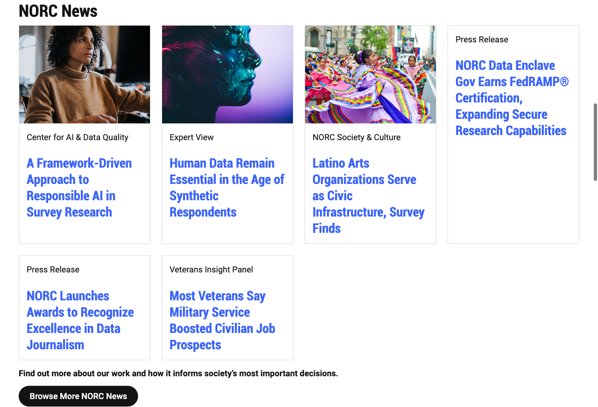
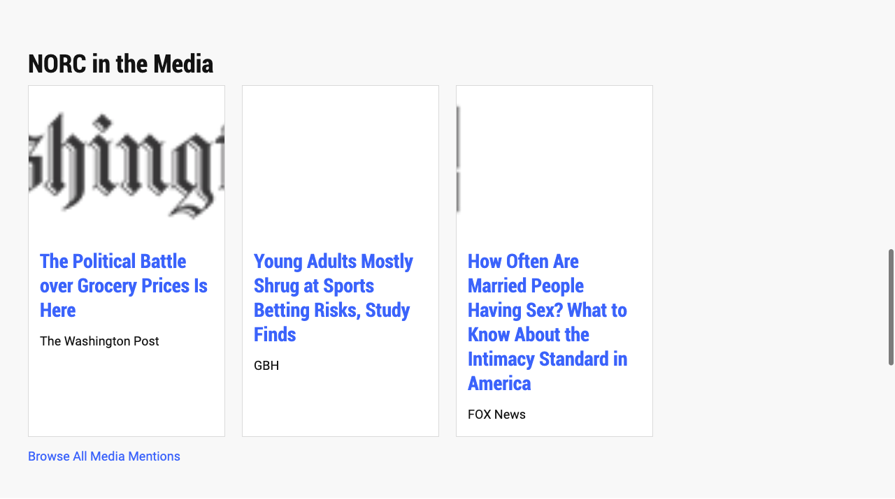
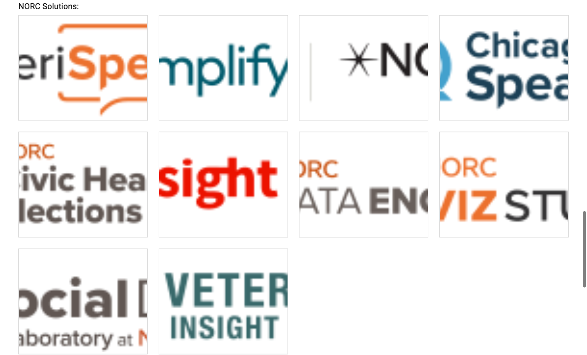
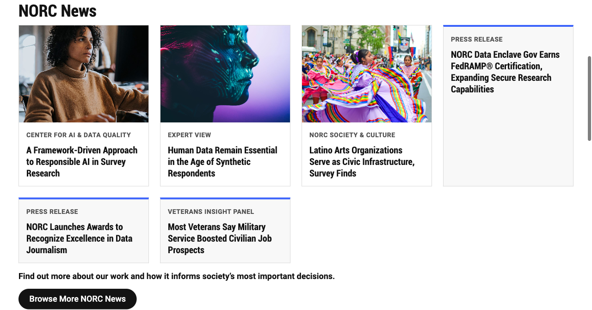
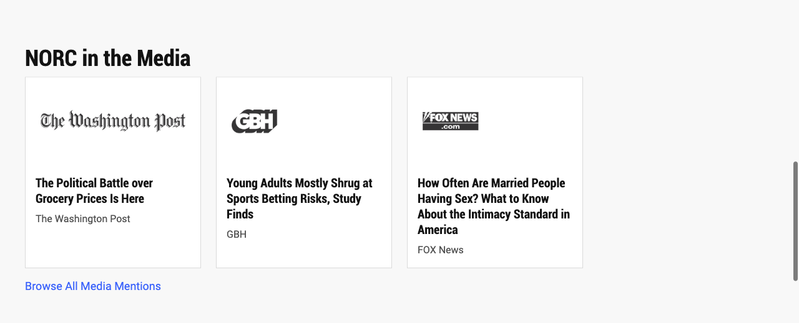
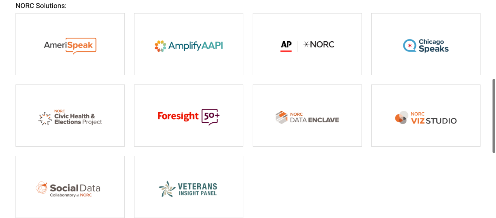

# How to use this document

This document is a worked example of every Session 3 exercise, done on one real NORC page. Use it in three ways:

1. **Demo script.** Each exercise has a *Say / Show / Run* box you can follow live.
2. **Answer key.** The worksheet's blank fields (selected section, content contract, files changed, test results) are filled in with real values.
3. **Rationale.** Every decision has a *Why* and the *Options we rejected*, so you can answer "why not X?" questions.

| Item | Value |
|---|---|
| Repository | `github.com/talrejaneeraj/norc-eds-test` (local: `<your-workspace>/norc-eds-test`) |
| Source NORC domain | `https://www.norc.org/` (imported in Session 2 into `norc/index.plain.html`) |
| Local page | `http://localhost:3006/norc/` |
| Test-content page | `http://localhost:3006/drafts/tmp/cards` |
| Feature branch | `cards-refactor`, commit `f101f2e`, pushed over HTTPS |
| Pull request | https://github.com/talrejaneeraj/norc-eds-test/pull/5 (draft, base `site-folders`) |
| Per-exercise docs | `01_Lab1…` to `05_Exercise4…` .docx: each objective in full, with Adobe course references and screenshots |
| Block refactored | **Cards** (existing boilerplate block) + new **`logos`** variant |
| Tooling | macOS + **Claude Code** with the Adobe `aem-edge-delivery-services` skills, used where the worksheet says WSL + GitHub Copilot |

## Adobe certification course map

Every concept used here comes from the Adobe course **Adobe Experience Manager Edge Delivery Services – Developer Professional (EDS-D200)**: https://certification.adobe.com/courses/1308 (Adobe ID sign-in needed). The per-exercise docs quote each lesson and include the course's screenshots.

| Exercise | Course module › lesson | What it backs up |
|---|---|---|
| 1: Content contract | Module 2 › Structure of a Page; Decorating the DOM; Block Development (boilerplate blocks, Block Collection, block options, block authoring design) | Sections/blocks/default content, reuse Cards, `Cards (logos)` variant, keep tables simple for authors |
| 2: Implement | Module 2 › Block Development (JS decorate, `loadBlock`, CSS scoping, development stack); Module 3 › Initial Setup (branch URLs, AEM CLI); Module 4 › Additional Best Practices (JS, CSS, GitHub) | One self-contained block, no `aem.js` edits, no frameworks, block-prefixed classes, mobile-first, short branch names |
| 3: Test | Module 4 › Block testing, PageSpeed Insights › Accessibility; Module 5 › Go-Live Checklist (content and design QA, performance) | Test page with variants, alt text + keyboard, Lighthouse, devices |
| 4: Review & PR | Module 3 › Development workflow (AEM Code Sync); Module 4 › Automated PR testing, GitHub management | Small PRs, test URLs in the PR, Code Sync PageSpeed comment, never push to `main` |

# 1. The exercise list

The deck and the worksheet number the work differently. The deck has **4 hands-on exercises**. The worksheet splits the same work into **6 labs**. This is how they map:

| Deck exercise (slide) | Worksheet lab | Time | What you produce |
|---|---|---|---|
| (Session start, slide 5) | **Lab 1**: Baseline & candidate selection | 10 min | Server running, git state recorded, candidate chosen |
| **Exercise 1**: Document your content contract (slide 11) | **Lab 2**: Understand the block + **Lab 3**: Model the content | 20 + 20 min | Block anatomy, content contract, acceptance criteria |
| **Exercise 2**: Implement or refactor (slides 13–14) | **Lab 4**: Implement with Copilot + Adobe Skills | 35 min | Working block, reviewed code |
| **Exercise 3**: Test the block (slide 16) | **Lab 5**: Validate content scenarios | 20 min | Test table, defect found and fixed |
| **Exercise 4**: Review and commit (slide 17) | **Lab 6**: Review, commit, PR | 15 min | Clean diff, commit, PR (stretch) |
| Definition of done (slide 18) | Final deliverables + Retrospective | — | Checklist |

## Every bullet, by exercise

**Lab 1: Baseline & candidate selection**

- Open the Session 2 repository in your editor
- Start the local server and show the imported page
- Record existing git changes before editing
- Select a realistic component to improve

**Exercise 1 / Labs 2–3: Content contract**

- Identify the source-page section and its purpose
- Trace authored content → section/block markup → `blocks/<name>/<name>.js` + `.css` → decorated DOM → rendering
- Identify default content versus blocks, section wrappers and section metadata
- Locate the block JavaScript and CSS; decide if the block is reusable or page-specific
- Compare the candidate with existing Cards/Columns patterns
- Make the reuse decision: default content / existing block / variant / new block
- Decide whether Cards, Columns, Hero or another standard block fits
- Fill in the field table (Image, Title, Description, CTA/URL, Other), with required/optional, example and "handling when absent"
- Write down the row structure and at least two variants
- Specify empty-state, long-text and responsive behavior
- Define acceptance criteria (deck: three; worksheet: five listed)
- Facilitator gate: get the contract approved before the AI edits code

**Exercise 2 / Lab 4: Implement**

- Create a feature branch after confirming the baseline is safe
- Ask the agent to inspect the current implementation and the reuse options
- Require a content model and acceptance criteria before any edit
- Approve the approach and limit the change to one block
- Review the generated content, JS and CSS yourself; record what you rejected or corrected

**Exercise 3 / Lab 5: Test**

- Original imported content
- No image / no CTA (missing optional image or description)
- Long title or description; extra item
- One entry and multiple entries
- Desktop and mobile
- Keyboard, semantics, alt text
- Console and network errors
- Capture at least one issue found and corrected

**Exercise 4 / Lab 6: Review & commit**

- `git status`, `git diff --check`, `git diff --stat`, `git diff`
- Diff contains only intended files; no secrets, local paths or unneeded packages
- Commit, push the feature branch, open a PR with the content model, screenshots, test evidence and limitations

# 2. The plan: why Cards on the NORC homepage

## The candidate sections on our imported page

The Session 2 import of www.norc.org produced 6 sections with these blocks:

| Section | Block used | Uses | Candidate? |
|---|---|---|---|
| 1. Featured stories | Carousel | 1 | No. Interactive behavior (slides, buttons) makes it a poor first lab. |
| 2. "NORC delivers objective…" | Default content + `highlight` style | 1 | No. No block, so nothing to model. |
| 3. **NORC News** | **Cards** | **6 cards** | **Yes** |
| 4. Research Divisions | Columns | 1 | Possible, but only one instance with a fixed layout |
| 5. **NORC in the Media** | **Cards** | **3 cards** | **Yes** |
| 6. **NORC Solutions** | **Cards** | **10 logo tiles** | **Yes** |

**Selected section:** the **Cards** block, which renders **three sections** of the same page: NORC News, NORC in the Media and NORC Solutions.

**Why change is needed:** we saw it in the browser before touching code:

| Problem seen in the "before" screenshots | Who it hurts |
|---|---|
| Logo images are **cropped**: GBH and FOX News logos are invisible, and every solution logo is cut off ("eriSpe", "mplify") | Readers; NORC brand |
| News cards without a photo look broken next to cards that have one | Readers |
| Category labels ("Press Release", "Expert View") look like body text | Readers scanning the page |
| Only the title text is clickable, not the card | Mouse, touch and keyboard users |
| Titles render at the full `h3` page size (34 px on mobile) | Readability |







## Why this is the right pick (the argument for the demo)

1. **It matches what the prerequisites ask for.** They say: "Start with the existing Cards or Columns block if it already meets the need." The facilitator notes add: "Demonstrate Cards/Columns first; avoid overly complex custom components."
2. **One block, three real content shapes.** The same block shows a news card (image + category + linked title), a media card (logo + title + outlet) and a logo tile (linked logo only). That makes the reuse-vs-new-block decision real, not theoretical.
3. **Slide 10's example fits.** The deck's "NORC Research Card" (title required; image, description, client optional; standard/featured variant) is exactly the NORC News card.
4. **It is shareable.** AmeriSpeak and Amplify AAPI in the same repo already use Cards (3 and 2 instances). Anything we improve is a candidate NORC shared standard (retrospective question 3).
5. **It is low risk.** No API calls, no forms, no search: the things the prerequisites say to avoid.

## Options we rejected

| Option | Why we said no |
|---|---|
| Carousel | Interactive JS and accessibility (live regions, buttons) is too big for a 35-minute lab |
| Columns (Research Divisions) | Only one instance and nothing visibly broken, so there's no variation to model |
| A new `news-card` + a new `logo-grid` block | Same table shape as Cards (image + text per row). The worksheet says a new block is "justified only when its content model or behavior is genuinely different." It isn't. |
| Fix the logos by re-cropping the images | Moves the problem to every author, forever. Code should handle logos once. |
| Auto-detect logos in JS | The author's intent ("these are logos") is clearer as an explicit **block option**, which is standard EDS. |

# 3. Exercise 1 (Labs 2–3): Understand the block and write the content contract

## Lab 2: Block anatomy, traced on our page

This is the "content → markup → code → rendered" chain from slide 7, with our real files:

| Stage | Where it lives | What it looks like for NORC News |
|---|---|---|
| **Authored content** | Document/DA table, here `norc/index.plain.html` | A table titled **Cards**; each row is image cell + text cell |
| **Generated markup** | Delivered HTML | `<div class="cards"><div><div><picture>…</picture></div><div><p>Expert View</p><h3><a>…</a></h3></div></div>…</div>` |
| **Block decoration** | `blocks/cards/cards.js` | Turns rows into `<ul><li>`, names cells `cards-card-image` / `cards-card-body`, makes optimized `<picture>` |
| **Visual presentation** | `blocks/cards/cards.css` | Grid of cards, `minmax(257px, 1fr)`, `4:3` cover images |

**Default content vs blocks** in the NORC News section: the `<h2>NORC News</h2>` heading and the two closing paragraphs ("Find out more…", "Browse More NORC News") are **default content**. Only the grid is a **block**.

**Section wrappers and section metadata:** NORC in the Media has `section-metadata` with `Style: highlight`, so the section gets the light-grey `highlight` class. NORC News and Solutions have no section metadata.

**Existing files involved:** `blocks/cards/cards.js`, `blocks/cards/cards.css`, `norc/index.plain.html`. No other code depends on the Cards classes.

**Reusable or page-specific?** Reusable: 5 instances across 3 sites in this repo.

**Current content pattern** (the original boilerplate JS, 17 lines): every row → `<li>`, a cell holding only a picture → image, everything else → body. There's no idea of an optional image, an eyebrow, a clickable card or a logo.

> **Say:** "Notice the block code knows nothing about NORC. It only knows rows and cells. That is why one block can serve News, Media and Solutions. Our job is to teach it about *optional* content and *logo* content, not to write a NORC-specific component."

## Lab 3: Reuse decision

**Decision: ☒ variant** (of the existing Cards block). We also improve the base Cards behavior; all of it is backward compatible.

**Block name:** `cards` (default) and `cards (logos)` (variant). Authors type the variant in the table header: **Cards (logos)**. EDS turns it into `class="cards logos"`.

## Content contract

This follows the content-modeling skill's **Collection** model: one row per item, at most 2 cells per row (the skill's limit is 4).

| Field / row | Required? | Example value (from norc.org) | Handling when absent |
|---|---|---|---|
| **Image** (cell 1) | N | Photo of Folklorico dancers; *The Washington Post* logo | Cell can be empty or missing. The card becomes text-only, with a blue top accent and light background so it doesn't look broken. |
| **Eyebrow** (first paragraph of cell 2, directly before the title) | N | "Expert View", "Press Release", "NORC Society & Culture" (the slide 10 "Client/sponsor" field) | Not shown; the title moves up |
| **Title** (heading in cell 2) | **Y** | "Human Data Remain Essential in the Age of Synthetic Respondents" | The card still renders, but it's an authoring error (flag it in review) |
| **Description / source** (paragraph(s) after the title) | N | "The Washington Post" (outlet), or a summary | Not shown |
| **CTA / URL** (link on the title, or on the logo) | N | research-library article URL | If there's no link, the card is not clickable. If there's exactly **one** link, the **whole card** is clickable. If there are 2+ links, each link works on its own and the card is not clickable as a whole (no ambiguous click targets). |
| **Variant** (block option) | N | `logos` | Default card: photo `4:3`, cropped to fill |

**Expected row structure (what an author types):**

```
| Cards (logos)          |                                         |
| [image or logo]        | Eyebrow (optional)                      |
|                        | ### [Linked title](https://…)           |
|                        | Source or description (optional)        |
| [next card image]      | …                                       |
```

**Variants and use cases (at least two):**

1. **`Cards` (default): news / research cards.** NORC News: photo (optional), eyebrow, linked title. Also AmeriSpeak and Amplify feature cards (image + title + description).
2. **`Cards (logos)`: logos, never cropped.** NORC in the Media (outlet logo + headline + outlet name) and NORC Solutions (linked logo tiles with no text). The logo is shown whole (`object-fit: contain`, `2:1` box, padding).

**Empty-state, long-text, responsive behavior** (deck bullet 4):

- *Empty:* text-only cards get an accent so a mixed row still looks deliberate; an empty image cell is removed, not rendered as blank space.
- *Long text:* titles wrap. `overflow-wrap: anywhere` stops long URLs or words from overflowing. No truncation, so authors see everything they typed.
- *Responsive:* a mobile-first grid, `repeat(auto-fill, minmax(257px, 1fr))`: 1 column on phones, 2 on tablets, 3–4 on desktop. No breakpoint code needed.

## Acceptance criteria

These are the worksheet's five, made testable for this block:

1. **AC1: Authors change content, not code.** Adding, removing or reordering cards, and switching to logos, is done in the table only (`Cards` → `Cards (logos)`).
2. **AC2: Reuse.** Extend the existing Cards block with a variant; no new block, no new dependency.
3. **AC3: Optional content is graceful.** No image, empty image cell, no eyebrow, no description and no link all render cleanly.
4. **AC4: No nested blocks, no hard-coded NORC content** in JS/CSS.
5. **AC5: Responsive, accessible, performant.** No horizontal scroll at 375 px; all images keep alt text; the whole-card link is keyboard-focusable with a visible focus ring; motion respects `prefers-reduced-motion`; lint passes; no new console errors.

> **Facilitator gate (worksheet):** stop here in the live demo and approve the table above *before* showing any code. That is the point of the lab: content first.

# 4. Exercise 2 (Lab 4): Implement with the agent + Adobe skills

## Branch: a real gotcha to demo

The three documents suggest **three different** branch names. We tested all three:

| Source | Suggested branch | `{branch}--norc-eds-test--talrejaneeraj` length | Works on aem.page? |
|---|---|---|---|
| Prerequisites | `feature/session-3-block-development` | **65** | **No**: over the 63-character DNS limit |
| Deck (slide 13) | `feature/improve-content-block` | 59 | Yes (barely) |
| Worksheet (Lab 4) | `feature/refactor-eds-block` | 56 | Yes |
| **We used** | `cards-refactor` | 44 | Yes |

When we created `feature/session-3-block-development`, the running `aem up` server **stopped itself** with: *"URL https://feature-session-3-block-development--norc-eds-test--talrejaneeraj.aem.page exceeds the 63 character limit for DNS labels."* The longer your repo name or GitHub username, the sooner you hit this. **Recommendation for NORC:** short branch names, e.g. `cards-logos`.

```bash
cd <your-workspace>/norc-eds-test
git status --short          # baseline was clean
git switch -c cards-refactor
claude                       # instead of: copilot
```

## The prompt (Claude Code version of slide 14)

The worksheet prompt works unchanged in Claude Code. The Adobe skills (content-driven-development, content-modeling, building-blocks, testing-blocks, code-review) load automatically.

```
Use the Adobe content-driven-development workflow to improve the selected
block on my imported NORC page.
1. Inspect the existing content, markup, CSS, and JavaScript.
2. Identify whether a boilerplate or Block Collection implementation can be reused.
3. Propose an author-friendly content model with required, optional, and variant fields.
4. Define acceptance criteria before modifying code.
5. After I approve the design, implement the changes using EDS conventions.
6. Preserve content and functionality; do not add unnecessary dependencies.
7. Explain the files changed and how to validate the implementation.

Selected block: cards
Details: norc/index.plain.html uses Cards three times: NORC News (photo optional,
category eyebrow, linked title), NORC in the Media (outlet logo + headline + outlet),
NORC Solutions (linked logo tiles). Logos are cropped by object-fit: cover; cards
without photos look broken; only the title is clickable. Also used on amerispeak/
and amplifyaapi/, so no regressions there.
Do not make code changes until the plan is approved.
```

## What changed: 3 files, +109 / −3

**1. `blocks/cards/cards.js`** adds 4 small behaviors. The original 17 lines are kept.

```js
[...li.children].forEach((div) => {
  /* authors leave the image cell empty when a card has no image */
  if (!div.children.length && !div.textContent.trim()) div.remove();
  else if (div.children.length === 1 && div.querySelector('picture')) div.className = 'cards-card-image';
  else div.className = 'cards-card-body';
});

/* image is optional: text-only cards get their own styling */
if (!li.querySelector('.cards-card-image')) li.classList.add('cards-card-no-image');

/* a paragraph directly before the title is the eyebrow (category or sponsor) */
const body = li.querySelector('.cards-card-body');
const first = body?.firstElementChild;
if (first?.tagName === 'P' && first.nextElementSibling?.matches('h2, h3, h4, h5, h6')) {
  first.className = 'cards-card-eyebrow';
}

/* a card with exactly one link is clickable as a whole */
const links = li.querySelectorAll('a[href]');
if (links.length === 1) {
  li.classList.add('cards-card-linked');
  links[0].classList.add('cards-card-link');
}
```

| Behavior | Why this way |
|---|---|
| Remove empty cells | DA and Word save a 2-column table even when the image cell is blank. Found in testing (see Exercise 3). |
| `cards-card-no-image` class | CSS can style text-only cards without guessing |
| Eyebrow = "paragraph right before a heading" | Authors don't need a special field or bold/italic code. They just type a line above the title. A paragraph *after* the title (Media: outlet name) stays a normal paragraph. |
| Whole-card link only when there's **exactly one** link | Uses the "stretched link" pattern: the real `<a>` stays the only link, so screen readers announce it once and the title is the link text. With 2+ links a whole-card click would be ambiguous, so we don't do it. |

**2. `blocks/cards/cards.css`** adds about 70 lines, all scoped to `.cards`:

| Rule | Purpose |
|---|---|
| `.cards-card-eyebrow` | Small, bold, uppercase, grey category label |
| `.cards-card-body h3` | Card titles at `--heading-font-size-s`, dark text (not the page's large `h3`) |
| `h3 ~ p` | Outlet/description in smaller grey text |
| `li.cards-card-no-image` | Blue top border + light background for text-only cards |
| `.cards-card-link::after { position:absolute; inset:0 }` | Makes the whole card the click target |
| `li:has(.cards-card-link:focus-visible)` | Visible 3 px focus ring around the **card** for keyboard users |
| `@media (hover:hover) and (prefers-reduced-motion:no-preference)` | 4 px lift + shadow on hover; off for touch and for reduced motion. Transform only, so it stays at 60 fps |
| `.cards.logos … img { object-fit: contain; aspect-ratio: 2/1; padding }` | **The variant.** Logos are never cropped. |

Everything uses existing boilerplate tokens (`--link-color`, `--dark-color`, `--light-color`, font-size variables), so the block will follow the NORC theme when Session styling lands. **No new dependencies, no fonts, no libraries.**

**3. `norc/index.plain.html`** changes 2 words of content: `cards` → `cards logos` on the Media and Solutions tables. In DA the author would rename the table header to **Cards (logos)**.

**Test content (not part of the PR): `drafts/tmp/cards.plain.html`** holds 8 scenarios built from the real NORC content (the CDD skill's "Option B, local HTML" approach).

## AI suggestions rejected or corrected (worksheet field)

| What happened | Correction |
|---|---|
| Worksheet Lab 6 says `git add .` | Rejected. The CDD skill says *"NEVER use `git add .`"*. It would have committed `drafts/` and a rewritten `package-lock.json`. Stage files by name. |
| `npm install` (to run lint) rewrote `package-lock.json` (+15/−42) | Reverted with `git checkout -- package-lock.json`; not part of this change |
| The first logo box was `3:2` with 24 px padding, leaving logos tiny in big white tiles | Tuned to `2:1`, `16px 24px` after looking at the screenshot |
| The first JS treated an empty image cell as a body | Fixed after the empty-cell test (Exercise 3) |
| The prerequisites' branch name | Too long for EDS; renamed to `cards-refactor` |

# 5. Exercise 3 (Lab 5): Validate content scenarios

Server: `aem up --url https://main--norc-eds-test--talrejaneeraj.aem.page --html-folder . --html-mount / --no-open --forward-browser-logs --port 3006`

| Test scenario | Result | Evidence |
|---|---|---|
| Original imported content (NORC page) | **Pass** | 5/5 blocks `loaded`, 20 images, 0 broken. Before/after screenshots below. |
| Missing optional image (mixed row) | **Pass** | Test page §2: text-only cards get the accent |
| Image cell left **empty** | **Fail → fixed → Pass** | Test page §2b: see "Defects" |
| Missing eyebrow and description; card with no link | **Pass** | §3: card renders and is *not* clickable |
| Long title + description + two links | **Pass** | §4: wraps cleanly; with 2 links the card isn't clickable as a whole and each link works |
| One entry only | **Pass** | §5 |
| Logos variant with text (Media) | **Pass** | §6 and NORC page: Washington Post, GBH, FOX logos all visible |
| Logos variant, tiles only (Solutions) | **Pass** | §7 and NORC page: all 10 logos whole |
| Desktop (1280) and mobile (375) | **Pass** | 4→1 columns; `scrollWidth` = 375 (no horizontal scroll) |
| Keyboard / semantics / alt text | **Pass** | Cards are `<ul><li>`; titles stay `<h3>`; every card image has alt text; focusing the title link draws the ring around the card |
| Console / network errors | **Pass** | Test page: 0 errors, 0 warnings. NORC page: only the 3 errors that were already there (`placeholders.json`, `section-metadata.css`), unrelated to Cards. |
| Lighthouse (a11y / best practices / SEO) | **Pass for Cards** | 95 / 96 / 63 on mobile and desktop; 0 failures inside Cards. Failures are header/footer touch targets, a local `head.html` 404 and preview `noindex`. |
| Regression: AmeriSpeak (3 Cards blocks), Amplify AAPI (2) | **Pass** | All `loaded`, 0 broken images, layout unchanged except the smaller, consistent title size |
| Lint (`npm run lint`: ESLint + Stylelint) | **Pass** | exit 0 |

## Defects found and corrected

1. **Empty image cell produced a blank gap and hid the eyebrow.** When an author leaves the image cell blank (normal in DA), the empty `<div>` was classed as a body. That added a blank 16 px margin, and because the code looked for the eyebrow in the *first* body (the empty one), the eyebrow was missed. **Fix:** remove empty cells before classifying (one line in `cards.js`).
   
   
2. **Branch name over the 63-character limit** stopped the dev server. Renamed the branch.
3. **Logo tiles were mostly white space** at `3:2`. Changed to `2:1`.

## After: the same three sections







Keyboard focus ring on a whole card:


Full test page, desktop: [img/test-desktop.jpg](img/test-desktop.jpg) · mobile: [img/test-mobile.jpg](img/test-mobile.jpg)

# 6. Exercise 4 (Lab 6): Review, commit, pull request

**Status: committed (`f101f2e`), pushed over HTTPS, and opened as draft PR #5** after your go-ahead.

```bash
git status --short
#  M blocks/cards/cards.css
#  M blocks/cards/cards.js
#  M norc/index.plain.html
# ?? drafts/                      <- local test content, do not commit
git diff --check                  # clean
git diff --stat                   # 3 files, +109 / -3
```

**Review checklist**

- ☒ The diff contains only the intended files (lockfile change reverted; `drafts/` excluded)
- ☒ No secrets, no `/Users/…` paths, no new packages
- ☒ Content model and test results documented (this document becomes the PR description)
- ☒ Feature branch pushed and PR opened: #5 (draft)

**Commands to ship** (staging by file name instead of the worksheet's `git add .`):

```bash
git add blocks/cards/cards.js blocks/cards/cards.css norc/index.plain.html
git commit -m "feat(cards): optional image, eyebrow, whole-card link, logos variant"
git push -u origin cards-refactor
gh pr create --title "Cards: author-friendly optional content and logos variant"
```

**PR test links** (required by the CDD skill):

- Before: `https://main--norc-eds-test--talrejaneeraj.aem.page/norc/`
- After: `https://cards-refactor--norc-eds-test--talrejaneeraj.aem.page/norc/`

**Limitation:** these links return 404 today. Even code files 404, so the **AEM Code Sync** GitHub app isn't connected to this repo yet, and there's no DA content source either. That's why the PR is a **draft** and has no Code Sync PageSpeed comment yet. To finish: install Code Sync, connect DA, create the test page, then switch the test links to `.aem.live` (the course and the repo's PR template both use `.aem.live`).

**Dependency:** `cards-refactor` was branched from `site-folders` (PR #4: per-site folders, headers and footers). Merge PR #4 first, then the Cards PR shows only these 3 files.

# 7. Definition of done (slide 18)

| Item | Status |
|---|---|
| Documented content model and reuse decision | ✅ Section 3 |
| Block works with the original migrated content | ✅ NORC page: 3 sections |
| Two additional content variants validated | ✅ 8 scenarios + logos variant |
| Desktop and mobile verified | ✅ 1280 / 375 |
| Change set reviewed and pushed | ✅ `cards-refactor`, `f101f2e` |
| PR opened (stretch) | ✅ #5 (draft); Code Sync PSI check pending |

# 8. Retrospective answers (worksheet last page)

- **What was easiest to reuse?** The boilerplate Cards block itself. Its row → `<li>` and cell → image/body logic needed no rewrite, and block options gave us a variant with zero new files.
- **What did the agent get wrong?** It followed `git add .` from the worksheet (this would have committed test content and a rewritten lockfile). It used the prerequisites' branch name, which is too long for EDS. Its first logo sizing left too much white space. It didn't handle an empty table cell until testing showed it.
- **Which block could be shared across NORC properties?** **Cards (logos)**: every NORC property has a "partners / solutions / as seen in" logo row. Cards itself, with the eyebrow, already serves NORC, AmeriSpeak and Amplify.
- **What should be standardized before production work?**
  - a branch-name rule (short, under the 63-character limit)
  - a shared token set (NORC colors and fonts in `styles.css`)
  - a list of approved block options (`logos`, …) so authors don't invent new ones
  - "stage by file name, never `git add .`"
  - a DA test page per block so PRs get real preview links

# 9. Live demo script (about 20 minutes)

| Min | Say | Show / Run |
|---|---|---|
| 0–2 | "One real NORC page, one existing block, three real uses." | `http://localhost:3006/norc/`; scroll to News, Media, Solutions |
| 2–5 | "Here's what's broken, and none of it is the author's fault." | The "before" screenshots: cropped logos, uneven text-only cards |
| 5–8 | "Content → markup → JS → CSS." | Open `norc/index.plain.html` (the table), then `blocks/cards/cards.js`, then DevTools showing `ul > li.cards-card-…` |
| 8–11 | "Contract before code." | Section 3 table and acceptance criteria. Ask the room to approve the gate. |
| 11–14 | "The agent proposes; I review." | Run `claude` with the prompt. Show the 4 JS behaviors and the `logos` CSS. Point out what we rejected. |
| 14–18 | "Test variability, not just looks." | `http://localhost:3006/drafts/tmp/cards`: §2b empty cell (the defect), §4 long title, §7 logos; resize to mobile; Tab to a card |
| 18–20 | "Review like a reviewer." | `git status`, `git diff --stat`. Explain the lockfile revert, why not `git add .`, and the branch-name limit. |

**Backup if something breaks live:** every screenshot is in `Session3-Demo/img/`, and the working branch `cards-refactor` is on disk.
