# What this exercise is for

**Goal:** understand exactly how authored content becomes the page, then decide *what authors maintain* before anyone writes JavaScript.

**Output:** a content contract (fields, required/optional, absent-handling), at least two variants, and acceptance criteria, approved at the facilitator gate.

| Deck slide 11 bullet | Where it is answered below |
|---|---|
| Identify your source-page section and its purpose | Part A, step 1 |
| Decide whether Cards, Columns, Hero or another block fits | Part B, step 5a |
| Describe required fields, optional fields and any variants | Part B, step 6 |
| Specify empty-state, long-text and responsive behavior | Part B, step 7 |
| Define three acceptance criteria before implementing | Part B, step 8 |

> **Say:** "A block is two things: an **authoring contract** and a **frontend implementation**. Today we design the contract first. Code comes after we agree on it."

## Adobe certification course reference

Every concept in this exercise comes from the official Adobe course **Adobe Experience Manager Edge Delivery Services – Developer Professional (EDS-D200)**, mostly **Module 2, "From Document to Page"**. Each step below has a **📘 Adobe course** note: which lesson it comes from, the course's own screenshot where it helps, and the public aem.live guide that lesson points to.

| | Link (Adobe ID sign-in needed for the course) |
|---|---|
| Course home | https://certification.adobe.com/courses/1308 |
| Module 2: From Document to Page | https://certification.adobe.com/courses/playScorm/1343/1308 |
| Lessons used | 2 "Structure of an Edge Delivery Services Page", 3 "Decorating the DOM", 4 "Block Development" |
| Module 4: Optimizing Content Delivery (CLS, Lighthouse alt text) | https://certification.adobe.com/courses/playScorm/1345/1308 |
| Module 5: Launching Your Website (Go-Live Checklist) | https://certification.adobe.com/courses/playScorm/1346/1308 |


*Verified: every module link above appears on the course home page (catalog ID EDS-D200), and every 🔗 lesson link below opens the named lesson inside that module. Module links need an Adobe ID sign-in; the direct lesson links open without one.*

> **Say:** "Nothing here is our own invention. Each decision maps to a lesson in Adobe's EDS developer course, and I'll show you which one as we go."

# Part A: Lab 2, understand the block (20 min)

## Step 1: Name the section and its purpose

**Our source page** is www.norc.org, imported to `norc/index.plain.html` (served at http://localhost:3006/norc/). The section we picked is the **Cards block**, which appears in three places on that page:

| Section on norc.org | How it's authored in our file | Items | Purpose (what to say) |
|---|---|---|---|
| **NORC News** | `<h2>NORC News</h2>` then `cards` | 6 cards | Drives clicks to the latest research. Each card: category ("Center for AI & Data Quality", "Expert View"), linked title, usually a photo. |
| **NORC in the Media** | `<h2>NORC in the Media</h2>` then `cards` | 3 cards | Builds trust through press coverage. Each card: outlet logo, headline, outlet name. |
| **NORC Solutions** | `<p>NORC Solutions:</p>` then `cards` | ~10 tiles | Sends visitors to NORC products (AmeriSpeak and others). Each tile: one linked logo. |

**Show:** the live site first, then our imported version of the same three sections (screenshots are in the Lab 1 doc, Step 5: `lab1-source-norc-*.jpg` and `before-*.png`).

> **Say:** "Three sections, three different jobs: News drives clicks, Media builds trust, Solutions routes to products. All three are the same block, **Cards**. The purpose tells us what each card needs: News needs a category and a link, Media needs the logo shown whole, Solutions needs only a clickable logo."

**Point out:** "NORC Solutions:" is a plain `<p>`, not an `<h2>` like the other two headings. It's **default content** outside the block (that's Step 3's topic). Turning it into a proper heading is a content fix in DA, not a block change.

> **📘 Adobe course:** Module 2 › Lesson 2, *Structure of an Edge Delivery Services Page*, intro. The course says the aim of document-based authoring is to keep authoring as simple as possible, so pages should closely match their source documents. That's why we begin from the real norc.org sections, not a design idea.
>
> 🔗 **Lesson:** Module 2 › Lesson 2: Structure of an Edge Delivery Services Page. **Direct link:** https://certification.adobe.com/scorm-data/1343/scormcontent/index.html#/lessons/htUJM8Sej0YW9zDd7aw48vWRqasu9aPJ
>
> 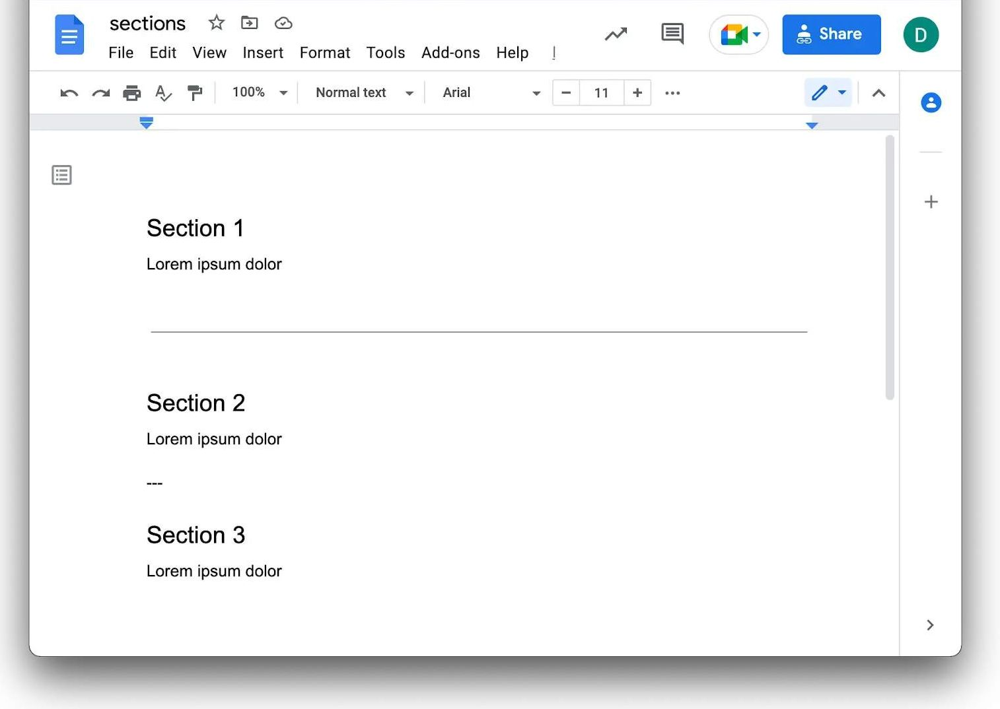{width=70%}

## Step 2: Trace content → markup → JS → CSS → screen

**Show this diagram** (built from the real files and the real browser DOM):

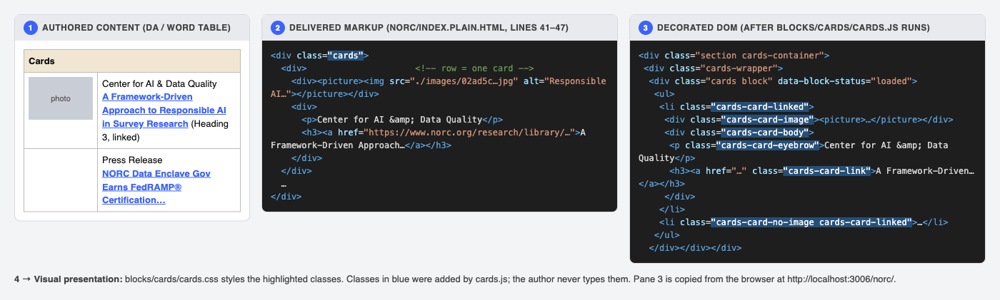{width=100%}

**Walk it left to right:**

1. **Authored content.** In DA or Word, the author makes a table titled **Cards**. Each row is one card: an image cell and a text cell.
2. **Delivered markup.** EDS turns the table into nested `<div>`s. `class="cards"` comes from the table title. That's all the author controls.
3. **Decorated DOM.** `blocks/cards/cards.js` turns rows into a `<ul><li>` list and adds the classes highlighted in blue. *Authors never type these classes.*
4. **Visual presentation.** `blocks/cards/cards.css` styles those classes.

> **📘 Adobe course:** Module 2 › Lesson 3, *Decorating the DOM*. The course calls this a **two-step process**: (1) AEM turns the document into clean semantic markup, which you can see with `view-source:` on the `.aem.page` URL; (2) `scripts.js`, `aem.js` and the block's JS enhance that markup into the DOM you style. Our diagram is that same two-step flow, drawn on our own NORC page.
>
> 🔗 **Lesson:** Module 2 › Lesson 3: Decorating the DOM. **Direct link:** https://certification.adobe.com/scorm-data/1343/scormcontent/index.html#/lessons/TtknoIOmDabkhLw-PRN509rvg8fkpeBS
>
> Here's the course's own Cards example after decoration. Note `cards-wrapper`, `cards block`, `<ul><li>`, `cards-card-image` and `cards-card-body`, the same classes as in our diagram:
>
> 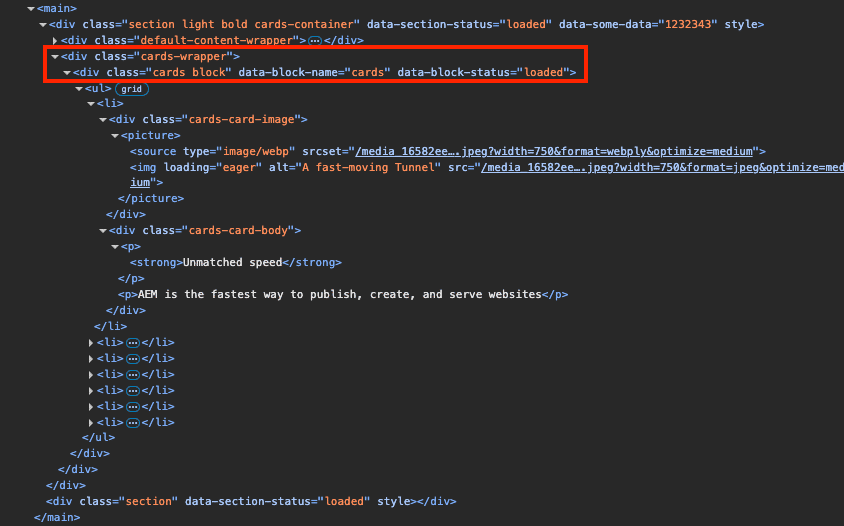{width=80%}
>
> Public guide: https://www.aem.live/developer/markup-sections-blocks

## Step 3: Show the authored table in VS Code

**Do:** in VS Code, open `norc/index.plain.html` and go to line 40.

**Show:**

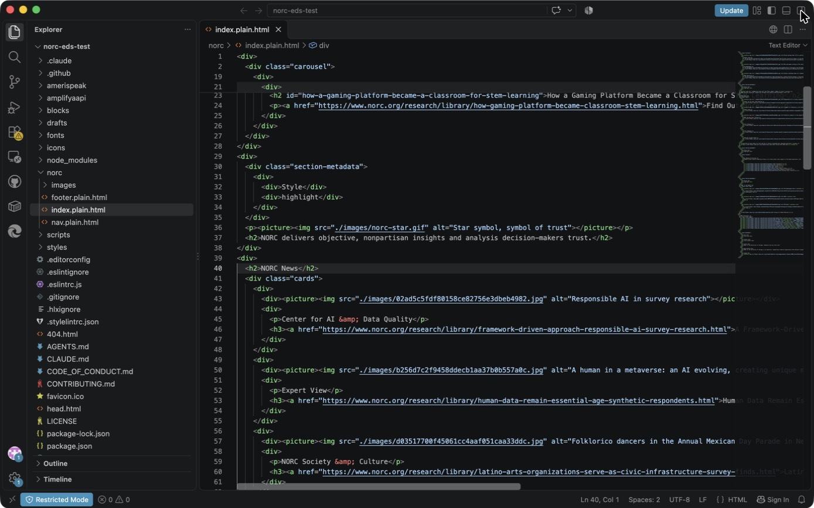{width=100%}

**Point at:**

- **Line 40, `<h2>NORC News</h2>`:** **default content**. It's a plain heading, not part of the block.
- **Line 41, `<div class="cards">`:** the **block** starts here.
- **Lines 42–48:** **one row = one card**. The first cell is the `<picture>`, the second holds `<p>` (category) and `<h3><a>` (linked title).
- **Lines 30–35, `section-metadata` → `Style: highlight`:** a **section wrapper setting**, which makes that section grey. It belongs to the section, not to the block.

> **Say:** "Notice what's *not* here: no CSS classes for eyebrow, no 'clickable' flag. The author writes plain content. Everything else is code's job."

> **📘 Adobe course:** Module 2 › Lesson 2, *Structure of an Edge Delivery Services Page*, sections **Sections**, **Section metadata**, **Default content** and **Blocks**. What the course teaches, and where it shows up in our file:
>
> 🔗 **Lesson:** Module 2 › Lesson 2: Structure of an Edge Delivery Services Page. **Direct link:** https://certification.adobe.com/scorm-data/1343/scormcontent/index.html#/lessons/htUJM8Sej0YW9zDd7aw48vWRqasu9aPJ
>
> | Course concept (paraphrased) | In our `norc/index.plain.html` |
> |---|---|
> | All content sits in a **section**; each section becomes a `<div>` | Each top-level `<div>` is one section |
> | **Section metadata** is a name/value table. `Style` becomes a class on the section `<div>`. Use it only when needed. | Lines 30–35, `Style: highlight` |
> | **Default content** is anything not in a block (headings, text, images, lists). Prefer it where you can. | Line 40, `<h2>NORC News</h2>` |
> | A **block** is a table whose first row is the block name | Line 41, `<div class="cards">` |
>
> The course's own example: a Cards table with a Section Metadata table under it in Google Docs. It's the same pattern as ours.
>
> 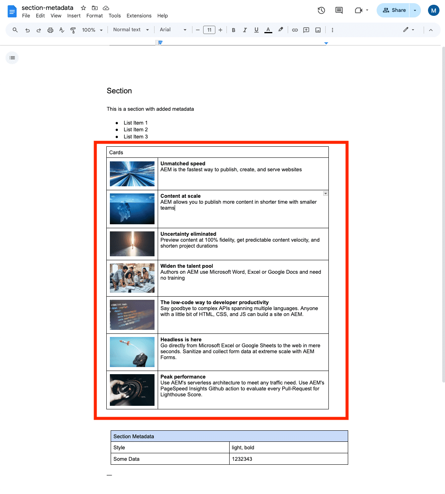{width=75%}
>
> Public guides: https://www.aem.live/developer/markup-sections-blocks#default-content, https://www.aem.live/developer/block-collection/section-metadata

## Step 4: Find the block code and judge reuse

**Show:** VS Code Explorer, `blocks/cards/` (`cards.js` + `cards.css`), and the original `cards.js`:

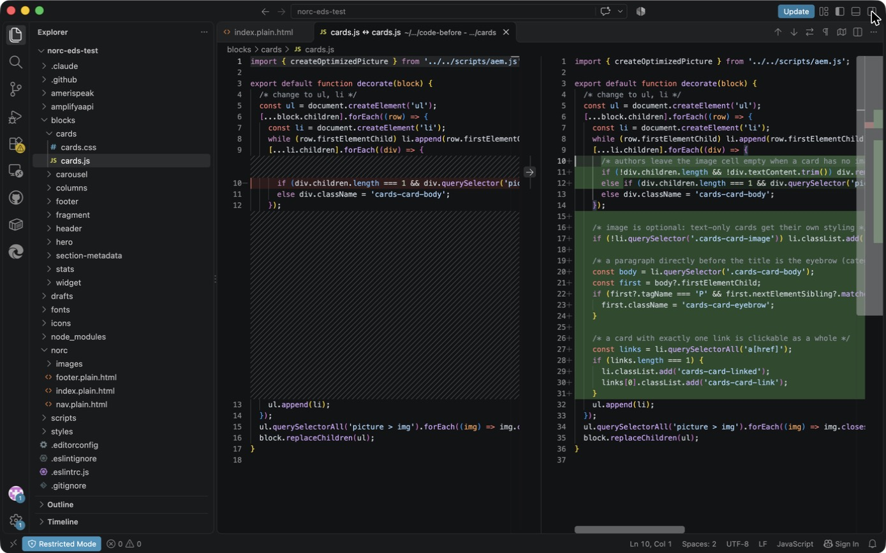{width=100%}

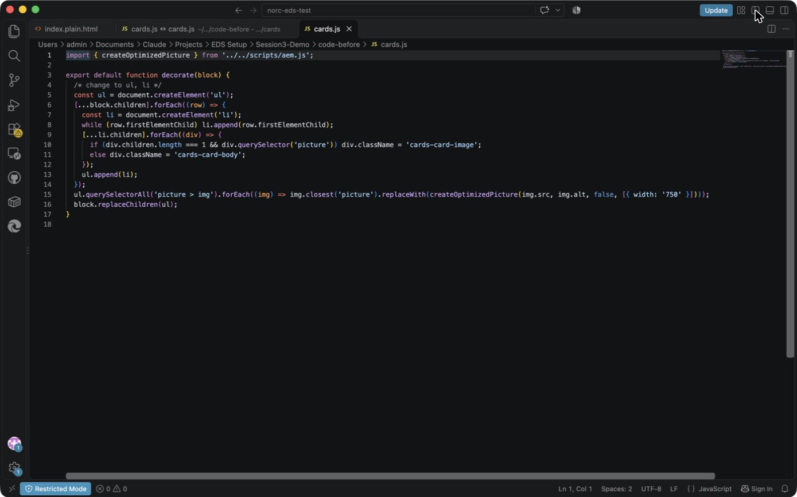{width=100%}

**Explain the original code line by line:**

- **Line 5:** create a `<ul>`.
- **Lines 6–8:** for each row, create an `<li>` and move the row's cells into it.
- **Lines 9–12:** a cell holding *only* a picture becomes `cards-card-image`; anything else becomes `cards-card-body`.
- **Line 15:** swap each image for an optimized, responsive `<picture>` (750 px).
- **Line 16:** replace the block contents with the list.

**What it does not know about:** optional images, an empty image cell, a category label, clickable cards, or logos.

**Reusable or page-specific?** **Reusable.** Cards appears 8 times across 3 sites in this repo (NORC ×3, AmeriSpeak ×3, Amplify AAPI ×2). That's why we fix the block, not the page.

> **📘 Adobe course:** Module 2 › Lesson 4, *Block Development*, sections **Boilerplate blocks**, **Block code** and **JavaScript › decorate function**.
>
> 🔗 **Lesson:** Module 2 › Lesson 4: Block Development. **Direct link:** https://certification.adobe.com/scorm-data/1343/scormcontent/index.html#/lessons/_dOUOg6VLpUUN-zwi9laYbxho37Nrt4v
>
> - Every block lives in `blocks/<name>/`, with `<name>.js` and `<name>.css` named after the folder. That's exactly where we found `blocks/cards/`.
> - Every block's JS exports a default `decorate` function, and the course uses the **Cards** block as its example. It's the same logic as our 17-line file; the only difference is the last step, which the course writes as `block.textContent = ''; block.append(ul)` and our copy writes as `block.replaceChildren(ul)`.
> - **Cards is a boilerplate block**: boilerplate blocks are in nearly every AEM project, widely tested, and meant to be customized. That's why we reuse it.
>
> 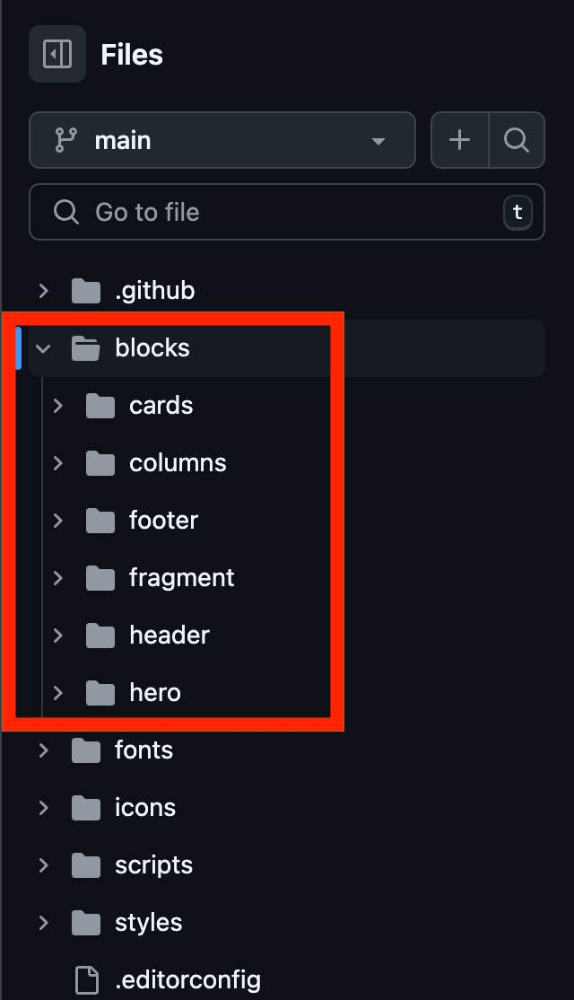{width=30%}
>
> 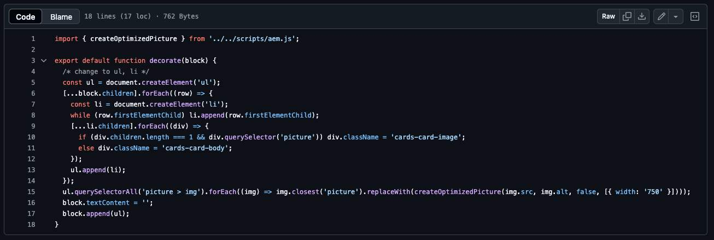{width=100%}
>
> Public guides: https://www.aem.live/developer/block-collection#boilerplate, https://github.com/adobe/aem-boilerplate/tree/main/blocks

# Part B: Lab 3, model the content (20 min)

## Step 5: Which standard block fits, and the reuse decision

### 5a. Does Cards, Columns, Hero or another standard block fit? (deck slide 11)

Choose by the **content's shape**, not its look. These are the standard blocks in our repo's `blocks/` folder: cards, columns, hero, carousel, fragment and stats.

| Block | Its content shape | Fits News / Media / Solutions? | Why |
|---|---|---|---|
| **Cards** | Many rows, each with *image + text* | ✅ **Yes** | Each news item, press mention or logo is one row with an image and text, and rows repeat |
| **Columns** | One row split into side-by-side panels | ❌ | Built for 2–3 panels, not a list of 6–10 repeating items; adding an item would mean adding a column |
| **Hero** | One large image plus a heading at the top of the page | ❌ | One per page and not repeating; the NORC page already has a carousel at the top |
| **Carousel** | Rotating slides | ❌ | Hides items behind arrows; news and logos should all be visible |
| **Default content** | Plain headings, text and images | ❌ | Can't lay out a grid of repeating image and text items |
| **New block** | — | ❌ | Not needed; this content isn't different enough from Cards |

> **Say:** "We didn't ask 'what should this look like'. We asked 'what *shape* is this content'. It's a repeating list of image plus text, which is exactly Cards. Columns is for side-by-side panels, Hero is a single banner, Carousel hides content."

> **📘 Adobe course:** Module 2 › Lesson 4, *Block Development*, sections **Boilerplate blocks**, **Block collection** and **Block Party**. The course's order of preference is: (1) boilerplate blocks such as Cards, Columns and Hero, which are in almost every project; (2) the Block Collection, blocks used on more than half of projects; (3) the Block Party, community blocks. It also says it's often more efficient to start from an existing block that roughly matches and adjust it than to build from scratch. Lesson 2 adds that authors should use **default content** wherever possible and reach for a block only when needed.
>
> 🔗 **Lesson:** Module 2 › Lesson 4: Block Development. **Direct link:** https://certification.adobe.com/scorm-data/1343/scormcontent/index.html#/lessons/_dOUOg6VLpUUN-zwi9laYbxho37Nrt4v
>
> 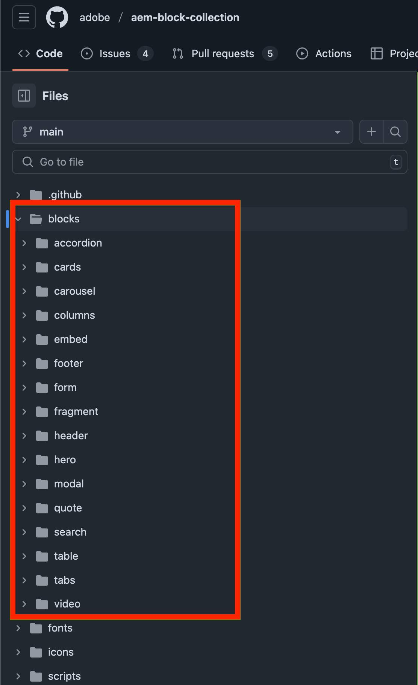{width=40%}
>
> Public guides: https://www.aem.live/developer/block-collection, https://www.aem.live/developer/block-party/

### 5b. The reuse decision (worksheet Lab 3)

The worksheet offers four choices:

| Option | Our choice? | Why |
|---|---|---|
| Default content | ✗ | Repeating structured items need a block |
| **Existing block** | ✓ (base improvements) | Cards already has the right shape: image + text per row |
| **Variant** | ✓ (`logos`) | Logos need different image behavior, but the same table |
| New block | ✗ | *"A new block is justified only when its content model or behavior is genuinely different"* (prerequisites §4). It isn't. |

**Decision:** improve **Cards** and add the **`Cards (logos)`** variant. In DA the author just renames the table header from **Cards** to **Cards (logos)**. EDS turns that into `class="cards logos"`.

**Show it in VS Code:** the Media and Solutions tables now say `cards logos` (lines 120 and 147):

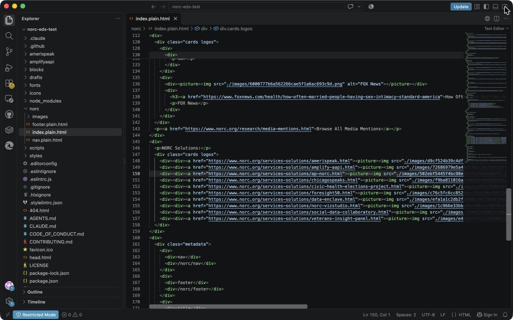{width=100%}

> **📘 Adobe course:** Module 2 › Lesson 2, *Structure of an Edge Delivery Services Page*, section **Block options**. Block options let authors change a block's look by adding classes to the block container, and developers then style or change behavior per class. The course's example is the **Cards** block itself: "Cards (wide)" becomes `<div class="cards wide block">`, which is exactly how "Cards (logos)" becomes `class="cards logos"`.
>
> 🔗 **Lesson:** Module 2 › Lesson 2: Structure of an Edge Delivery Services Page. **Direct link:** https://certification.adobe.com/scorm-data/1343/scormcontent/index.html#/lessons/htUJM8Sej0YW9zDd7aw48vWRqasu9aPJ
>
> 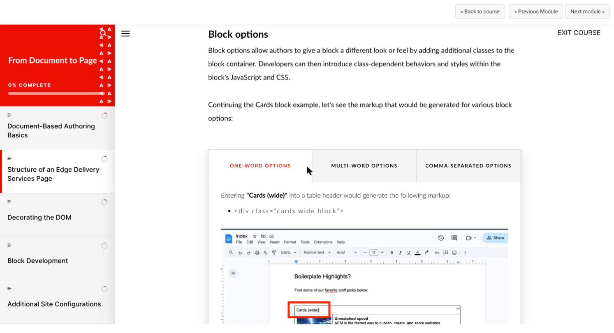{width=100%}
>
> Public guide: https://www.aem.live/developer/markup-sections-blocks#block-options

## Step 6: The content contract (fill-in table)

This follows the Adobe content-modeling skill's **Collection** model: one row per item, at most 4 cells (we use 2).

| Field / row | Required? | Example value (from norc.org) | Handling when absent |
|---|---|---|---|
| **Image** (cell 1) | ☐ Y ☒ N | Folklorico dancers photo; Washington Post logo | Card becomes text-only, with a blue top accent and light background. An **empty** image cell is removed. |
| **Image alt text** (on the image) | ☒ Y ☐ N *(whenever there's an image)* | "The Washington Post", "AmeriSpeak" | Must not be empty. On a logo-only tile it's the link's only name for screen readers. Flag it in review; Lighthouse reports it too. |
| **Title** (heading in cell 2) | ☒ Y ☐ N *(default `Cards`)*; ☐ Y ☒ N *(`logos` tiles)* | "Human Data Remain Essential in the Age of Synthetic Respondents" | Default Cards: renders, but flag it in review as an authoring error. Logo tiles (NORC Solutions) have no title by design; the alt text names the tile. |
| **Description** (paragraph after the title) | ☐ Y ☒ N | "The Washington Post" or a summary | Not shown |
| **CTA / URL** (link on title or logo) | ☐ Y ☒ N | research-library article URL | 0 links: card not clickable. 1 link: **whole card** clickable. 2+ links: each link works on its own. |
| **Other: eyebrow** (paragraph directly *before* the title) | ☐ Y ☒ N | "Expert View", "Press Release" (slide 10's "Client/sponsor") | Not shown; title moves up |
| **Other: variant** | ☐ Y ☒ N | `logos` | Default: photo 4:3, cropped to fill |

**At a glance (say this before walking the table):**

- **Required:** a **title** on every default card, and **alt text** on every image.
- **Optional:** image, eyebrow, description, link.
- **Variant:** `logos`, chosen by the author in the table header.

**Expected row structure (what the author types).** There are three real shapes on `/norc/`:

```
NORC News: Cards (6 rows like this)
| Cards                  |                                    |
| [photo]                | Eyebrow (optional)                 |
|                        | ### [Linked title](https://…)      |

NORC in the Media: Cards (logos) (3 rows like this)
| Cards (logos)          |                                    |
| [outlet logo]          | ### [Linked headline](https://…)   |
|                        | Outlet name (description)          |

NORC Solutions: Cards (logos) (10 rows, one cell each)
| Cards (logos)          |
| [linked logo]          |
```

**Point at:** `norc/index.plain.html` line 148. A Solutions tile is one cell holding `<a><picture>`: no title, no text. The code still marks it `cards-card-image`, and because it has exactly one link, the whole tile is clickable.

**Variants and use cases:**

1. **`Cards`**: news and research cards (NORC News; AmeriSpeak and Amplify feature cards).
2. **`Cards (logos)`**: logos never cropped (NORC in the Media; NORC Solutions).

> **Say:** "Required means the card is wrong without it; optional means the card still looks deliberate without it. Logos aren't a different *content model*, just a different *image behavior*, so they're a variant, not a new block."

> **📘 Adobe course:** where the field rules come from:
>
> 🔗 **Lesson:** Module 2 › Lesson 4: Block Development. **Direct link:** https://certification.adobe.com/scorm-data/1343/scormcontent/index.html#/lessons/_dOUOg6VLpUUN-zwi9laYbxho37Nrt4v
> 🔗 **Also:** Module 2 › Lesson 2: Structure of an Edge Delivery Services Page. https://certification.adobe.com/scorm-data/1343/scormcontent/index.html#/lessons/htUJM8Sej0YW9zDd7aw48vWRqasu9aPJ
> 🔗 **Also:** Module 4 › PageSpeed Insights. https://certification.adobe.com/scorm-data/1345/scormcontent/index.html#/lessons/5bMlTz-yUMoxyiXU9fAhGqsDQKm2I7Ea
> 🔗 **Also:** Module 5 › Go-Live Checklist. https://certification.adobe.com/scorm-data/1346/scormcontent/index.html#/lessons/tVlzeBUh57XSCsowBwLysj3lGB39YFkl
>
> - **Rows and cells → nested `<div>`s**: Module 2 › Lesson 4, *Block Development* › *Block authoring design*. A block's table becomes nested `<div>`s, one per row and cell. That's why "one row = one card" and "cell 1 = image" is the whole contract.
>
>   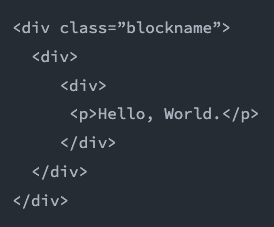{width=30%}
>
> - **Variant = block option**: Module 2 › Lesson 2, *Block options* (see Step 5b).
> - **Alt text is required**: Module 4 *Optimizing Content Delivery* › Lesson *PageSpeed Insights* (Lighthouse's accessibility check looks at alt text), and Module 5 *Launching Your Website* › Lesson *Go-Live Checklist* (check images have appropriate alt text before launch).
> - **Images render as responsive `<picture>`**: Module 2 › Lesson 2, *Default content*. That's why the contract only asks for "an image", never sizes or formats.

> **📘 Adobe course:** Module 2 › Lesson 4, *Block Development*, section **Block authoring design**. Three points drive our contract:
>
> 🔗 **Lesson:** Module 2 › Lesson 4: Block Development. **Direct link:** https://certification.adobe.com/scorm-data/1343/scormcontent/index.html#/lessons/_dOUOg6VLpUUN-zwi9laYbxho37Nrt4v
>
> 1. **Keep things simple and intuitive for authors**; the development team absorbs the complexity. *That's why the eyebrow is just "a line above the title", not a new column.*
> 2. An author should be able to copy and paste a block and understand how each table change affects the page. *That's why it stays one row per card.*
> 3. **Don't parameterize blocks** by treating table cells as arguments; the code should adapt the markup the author already wrote. *That's why there's no "clickable: yes" cell: one link means the whole card is clickable.*
>
> 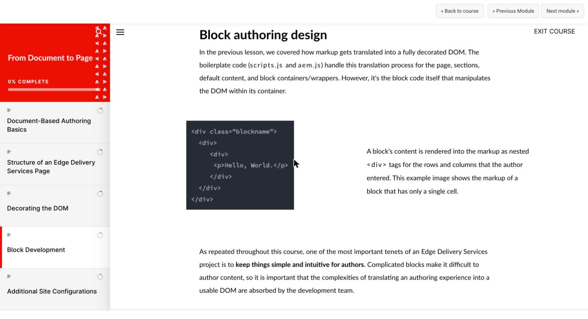{width=100%}
>
> The Adobe content-modeling skill's **Collection** model (one row per item, at most 4 cells) is the agent-side version of the same guidance. Public guides: https://www.aem.live/docs/davidsmodel, https://www.aem.live/developer/markup-sections-blocks#blocks

## Step 7: Empty-state, long text, responsive

For each behavior, the contract says *what the author will see*. The CSS/JS column is how Exercise 2 delivers it, and the last column is where Exercise 3 proves it.

**Empty states**

| Situation | Behavior | How (code) | Proved in Exercise 3 |
|---|---|---|---|
| Card has no image | Text-only card with a blue top accent and light background, so a mixed row looks deliberate | `li.cards-card-no-image` (`cards.css` lines 67–71) | Scenario 2 |
| Image cell left **empty** | The empty cell is removed: no blank gap, and the eyebrow still works | `div.remove()` in `cards.js` | Scenario 2b (the defect we found) |
| No eyebrow / description / link | Not shown; the card is not clickable when it has no link | Classes only added when the content exists | Scenario 3 |
| Only **one** card | Stays card-sized (one grid column) instead of stretching across the page | `auto-fill` keeps the empty grid tracks | Scenario 5 |

**Long text**

| Situation | Behavior | How (code) | Proved in Exercise 3 |
|---|---|---|---|
| Long title, or one very long word or URL | Wraps; never overflows the card | `overflow-wrap: anywhere` on the card `h3` (`cards.css` line 53) | Scenario 4 |
| Long description | Wraps normally | — | Scenario 4 |
| Anything long | **Nothing is truncated** (no `…`, no line clamp), so authors always see everything they typed | No `text-overflow` or `line-clamp` in `cards.css` | Scenario 4 |

**Responsive**

| Width | Columns | How (code) |
|---|---|---|
| Phone (375 px) | 1 | `grid-template-columns: repeat(auto-fill, minmax(257px, 1fr))` (`cards.css` line 6): as many 257 px+ columns as fit, with **no breakpoint code** |
| Tablet (768 px) | 2 | same rule |
| Desktop (1200 px) | 4 | same rule |
| Images | Photos keep a fixed **4:3** shape; logos a fixed **2:1** shape | `aspect-ratio` reserves the space before the image loads, so nothing jumps (no layout shift) |
| Touch screens | No hover lift on phones | Hover effect only runs under `(hover: hover)` |

> **Say:** "This is the contract's promise to authors: whatever you leave out, whatever you type, on whatever screen, the card still looks intentional. And we'll prove each row in Exercise 3."

> **📘 Adobe course:**
>
> 🔗 **Lesson:** Module 4 › PageSpeed Insights. **Direct link:** https://certification.adobe.com/scorm-data/1345/scormcontent/index.html#/lessons/5bMlTz-yUMoxyiXU9fAhGqsDQKm2I7Ea
> 🔗 **Also:** Module 5 › Go-Live Checklist. https://certification.adobe.com/scorm-data/1346/scormcontent/index.html#/lessons/tVlzeBUh57XSCsowBwLysj3lGB39YFkl
> 🔗 **Also:** Module 2 › Lesson 4: Block Development. https://certification.adobe.com/scorm-data/1343/scormcontent/index.html#/lessons/_dOUOg6VLpUUN-zwi9laYbxho37Nrt4v
> 🔗 **Also:** Module 2 › Lesson 2: Structure of an Edge Delivery Services Page. https://certification.adobe.com/scorm-data/1343/scormcontent/index.html#/lessons/htUJM8Sej0YW9zDd7aw48vWRqasu9aPJ
>
> - **Layout stability:** Module 4 *Optimizing Content Delivery* › Lesson *PageSpeed Insights*, section **Cumulative Layout Shift (CLS)**. CLS measures elements jumping as the page loads; it's 25% of the Lighthouse performance score and is tracked separately for mobile and desktop. That's why images get a fixed `aspect-ratio`.
> - **Mobile and desktop both matter:** Module 5 *Launching Your Website* › Lesson *Go-Live Checklist*. Aim for a Lighthouse score of 100 on both mobile and desktop, and check that images render properly on mobile before launch.
> - **Simple, scoped CSS:** Module 2 › Lesson 4 *Block Development* › *CSS*. Prefix every selector with the block class and avoid complex, brittle selectors. That's why one grid rule replaces a set of breakpoints.
> - **Responsive images for free:** Module 2 › Lesson 2 › *Default content*. Every image becomes a `<picture>` with desktop and mobile sizes and webp.
>
> Public guide: https://www.aem.live/developer/keeping-it-100
>
> 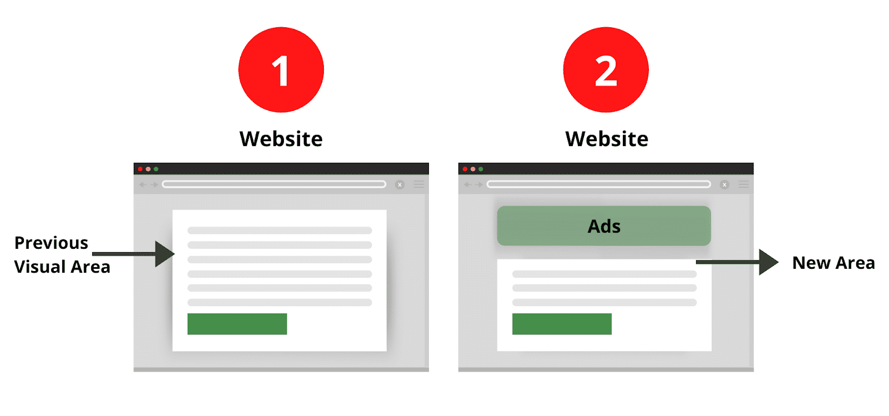{width=70%}

## Step 8: Acceptance criteria

**Why now:** criteria are written **before** any code, so "done" is agreed in advance and can't drift to fit whatever the agent produces. In this exercise ☒ means *agreed at the facilitator gate*; pass or fail is recorded in Exercise 3.

The deck asks for three and the worksheet lists five; we wrote five, made testable. **If you only have time for three, lead with 1, 3 and 5**: authoring, optional content, quality. Criteria 2 and 4 are guard-rails the reviewer checks in the diff.

1. ☒ **The author changes content, not code.** Add, remove or reorder cards and switch to logos in the table only.
2. ☒ **Reuse.** Extend Cards with a variant; no new block, no new dependency.
3. ☒ **Optional content is graceful.** No image, empty image cell, no eyebrow, no description and no link all look right.
4. ☒ **No nested blocks and no hard-coded NORC content** in JS/CSS.
5. ☒ **Responsive, accessible, performant.** No horizontal scroll at 375 px, alt text kept, keyboard focus visible, `prefers-reduced-motion` respected, lint clean.

**What makes each criterion testable:**

| # | How we test it | Pass condition | Where it's proved |
|---|---|---|---|
| 1 | Change only the table: add or remove a row, rename the header to `Cards (logos)` | Page updates correctly with **no** change to `cards.js` / `cards.css` | Exercise 3 test page (8 scenarios, content only); Exercise 2 Step 6 (the only page change is the header) |
| 2 | `git diff --stat` and `package.json` | Only `blocks/cards/*` and the page changed; no new block folder; `package.json` and the lockfile unchanged | Exercise 4 Step 2 (3 files, +109 / −3) |
| 3 | Test page scenarios 2, 2b, 3, 4 and 5 | Every card looks deliberate: no blank gap, no broken layout | Exercise 3 Step 2 |
| 4 | Read the diff; search the block code for site names | No block inside a block; no "NORC", URLs or copy in `cards.js` / `cards.css`; every selector starts with `.cards` | Exercise 2 Steps 4–5 |
| 5 | DevTools at 375 px, Tab key, Console, `npm run lint` | `scrollWidth === 375`; focus ring on the card; all alt text kept; 0 new console errors; lint passes | Exercise 3 Step 4 |

> **Say:** "Every criterion has a test and a pass condition. If we can't test it, it isn't a criterion, it's a wish."

> **📘 Adobe course:** where each criterion comes from:
>
> 🔗 **Lesson:** Module 2 › Lesson 4: Block Development. **Direct link:** https://certification.adobe.com/scorm-data/1343/scormcontent/index.html#/lessons/_dOUOg6VLpUUN-zwi9laYbxho37Nrt4v
> 🔗 **Also:** Module 2 › Lesson 2: Structure of an Edge Delivery Services Page. https://certification.adobe.com/scorm-data/1343/scormcontent/index.html#/lessons/htUJM8Sej0YW9zDd7aw48vWRqasu9aPJ
> 🔗 **Also:** Module 4 › PageSpeed Insights. https://certification.adobe.com/scorm-data/1345/scormcontent/index.html#/lessons/5bMlTz-yUMoxyiXU9fAhGqsDQKm2I7Ea
>
> | Criterion | Course source (Module 2 unless noted) |
> |---|---|
> | 1. Author changes content, not code | Lesson 4, *Block authoring design*: authors change the table; developers absorb the complexity |
> | 2. Reuse an existing block or variant | Lesson 4, *Boilerplate blocks / Block collection*; Lesson 2, *Block options* |
> | 3. Optional content is graceful | Lesson 4, *Block authoring design*: code adapts to the markup the author provided |
> | 4. No nested blocks, nothing hard-coded | Lesson 2, *Blocks*: blocks should never be nested. Lesson 4, *CSS*: scope every selector to the block class (`.cards …`) |
> | 5. Responsive, accessible, performant | Lesson 2, *Default content*: every image renders as a responsive `<picture>` (desktop/mobile sizes, webp). Lesson 4, *loadBlock*: only blocks on the page load their JS/CSS. Module 4, *PageSpeed Insights*: Lighthouse checks alt text and keyboard navigation |
>
> 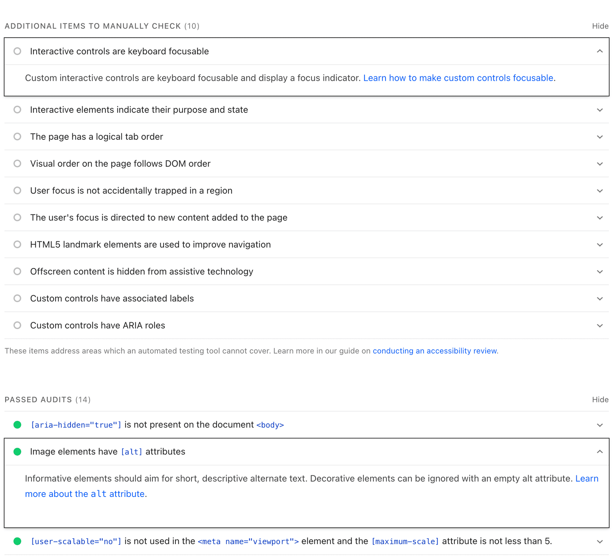{width=70%}

# Facilitator gate

> **Say (stop here):** "Before anyone touches code, does this contract make sense to the authors in the room? If yes, we approve it, and only then does the agent edit files."

☒ Content contract reviewed and implementation approach approved before the AI edits code.

**When:** the facilitator notes say to enforce this approval **at minute 50** of the session, before anyone starts Lab 4.

**Gate checklist (ask the room, one line each):**

| Question to the room | Answer we show | From |
|---|---|---|
| Is this the right section, for the right purpose? | News, Media and Solutions on `/norc/` | Step 1 |
| Is reusing Cards (plus a `logos` variant) right, rather than a new block? | Yes: same content shape; logos are a block option | Step 5 |
| Could an author fill this table in without asking a developer? | One row per card; optional lines are just typed or left out | Step 6 |
| Do we agree what happens when content is missing, long, or on a phone? | The three tables | Step 7 |
| Do we agree what "done" means? | 5 criteria, each with a test | Step 8 |

**If the room says no:** change the **contract** (the tables above), not code. There's no code yet, which is the whole point: changing a table costs minutes, changing an implementation costs hours.

**How the gate carries into Exercise 2:** the prompt we give the agent ends with *"Do not make code changes until the plan is approved."* The agent proposes the same contract back, and we approve it with an explicit scope: only `blocks/cards/*` and the two table headers.

> **Say:** "Content first, code second. That's the Content Driven Development rule from Adobe's skill, and it's why the agent isn't allowed to touch a file until this gate is passed."

> **📘 Adobe course:** Module 2 › Lesson 4 *Block Development* › **Block authoring design**. The course gives a three-step order for designing a block's table: (1) picture how the block will look and work on the page; (2) choose the table structure an author would find easiest to understand; (3) only then judge how far that table's markup is from the final HTML. The gate is where we confirm steps 1–2 are agreed before anyone does step 3, the code.
>
> 🔗 **Lesson:** Module 2 › Lesson 4: Block Development. **Direct link:** https://certification.adobe.com/scorm-data/1343/scormcontent/index.html#/lessons/_dOUOg6VLpUUN-zwi9laYbxho37Nrt4v
>
> {width=70%}

**Worksheet fields:**

- **Current content pattern:** row = image cell + text cell; no notion of optional, eyebrow, link or logo.
- **Existing files involved:** `blocks/cards/cards.js`, `blocks/cards/cards.css`, `norc/index.plain.html`.
- **Block name / candidate:** `cards` + `cards (logos)`.

# Questions you may get

- **"Why not make the eyebrow its own column?"** It would be a third cell authors must leave empty most of the time. A line typed above the title is how authors already write it.
- **"Why is 'logos' a variant and not auto-detected?"** The author's intent is explicit and reviewable; auto-detection guesses. Block options are the standard EDS way.
- **"Why not crop the logo images instead?"** That pushes the problem onto every author, forever.
