# What this exercise is for

**Goal:** have the AI agent implement the approved content contract inside **one** block, then review every line yourself.

**Output:** a working Cards block, a list of changed files, and a note of what you rejected or corrected.

The flow is deck slide 12: **Analyze → Plan → Approve → Implement**. Exercise 1 did Analyze and Plan; this exercise is Approve and Implement.

| Deck slide 13 bullet | Where it is covered |
|---|---|
| Ask the agent to inspect the existing implementation and reuse options | Step 2 (prompt items 1–2) |
| Require a content model and acceptance criteria before edits | Step 2 (items 3–4; done in Exercise 1) |
| Approve the approach and limit the change to one block | Step 3 |
| Review the generated content, JS and CSS in VS Code | Steps 4–6 |

| Worksheet Lab 4 checklist item | Where it is covered |
|---|---|
| Copilot (the agent) summarized the current implementation | Step 2, "What the agent reported" |
| Reviewed reuse vs new-block recommendation | Step 2, "What the agent reported" |
| Approved the model before code changes | Step 3 |
| Implemented / refactored the selected block | Steps 4–6 |
| Inspected changed files rather than accepting generated code blindly | Steps 4–6 |
| Files changed | Worksheet fields |
| AI suggestion rejected or corrected | Worksheet fields (4 corrections) |

> **Say:** "The agent is fast, but it's not the reviewer. Our job in this exercise is to scope it, approve it and read what it wrote."

## Adobe certification course reference

Each step below has a **📘 Adobe course** note from the official course **Adobe Experience Manager Edge Delivery Services – Developer Professional (EDS-D200)**.

| | Link (Adobe ID sign-in needed for the course) |
|---|---|
| Course home | https://certification.adobe.com/courses/1308 |
| Module 2: From Document to Page (Lesson 4 "Block Development") | https://certification.adobe.com/courses/playScorm/1343/1308 |
| Module 3: Setting Up Edge Delivery Services (Lesson "Initial Setup and Configuration") | https://certification.adobe.com/courses/playScorm/1395/1308 |
| Module 4: Optimizing Content Delivery (Lesson "Additional Best Practices") | https://certification.adobe.com/courses/playScorm/1345/1308 |


*Verified: every module link above appears on the course home page (catalog ID EDS-D200), and every 🔗 lesson link below opens the named lesson inside that module. Module links need an Adobe ID sign-in; the direct lesson links open without one.*

# Step 1: Create the feature branch, and the gotcha

**Do:** confirm the baseline is safe (the tree is clean and the page still loads), then branch.

```bash
git status        # expect: nothing to commit, working tree clean
git switch -c cards-refactor
```

**Show what happened when we used the prerequisites' branch name:**

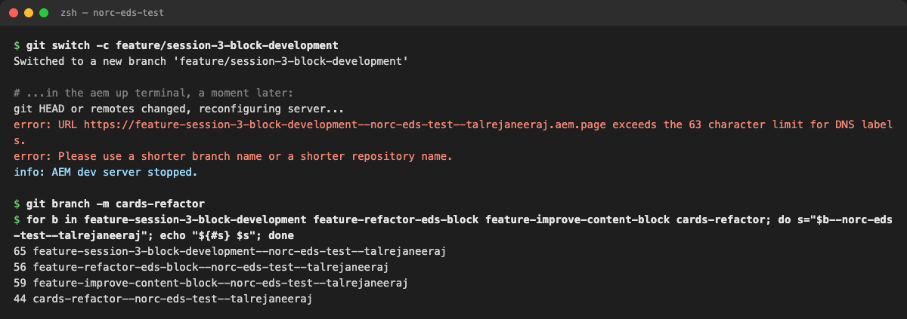{width=100%}

**Explain:** an EDS preview address is `{branch}--{repo}--{owner}.aem.page`, and that first part must be **63 characters or fewer** (it's a single DNS label; `/` becomes `-`). The three Session 3 documents suggest three different names:

| Source | Branch | Length of `{branch}--norc-eds-test--talrejaneeraj` | Works? |
|---|---|---|---|
| Prerequisites | `feature/session-3-block-development` | 65 | **No** |
| Deck slide 13 | `feature/improve-content-block` | 59 | Yes |
| Worksheet Lab 4 | `feature/refactor-eds-block` | 56 | Yes |
| **We used** | `cards-refactor` | 44 | Yes |

> **Say:** "This is a real production gotcha. Long repo names and usernames eat the budget fast. Short branch names, always."

```bash
claude          # the worksheet uses: copilot
```

> **📘 Adobe course:** Module 3 › *Initial Setup and Configuration*, sections **Selecting content and code with URLs** and **AEM Command Line Interface (CLI)**.
>
> 🔗 **Lesson:** Module 3 › Initial Setup and Configuration. **Direct link:** https://certification.adobe.com/scorm-data/1395/scormcontent/index.html#/lessons/mopjdHluFIPYbbWleIqmjkXQPJHYN01L
> 🔗 **Also:** Module 4 › Additional Best Practices. https://certification.adobe.com/scorm-data/1345/scormcontent/index.html#/lessons/yzfcSloqZm2Y8B2rrt8bFe-HGNfXtkWC
>
> - Every branch gets its own preview at `https://<branch>--<repo>--<owner>.aem.page/` (and `.aem.live`). The course calls this "a 1:1 preview environment for each active branch", so you don't need a staging environment. That's why the branch name matters: it becomes part of a URL.
> - The course's own example branch is short and ticket-style: `ft-1283-contact-page`. Ours, `cards-refactor`, follows the same pattern.
> - The AEM CLI (`aem up`) is how a developer tests changes locally **before** pushing a branch. That's the server the long name broke.
> - The course doesn't state the 63-character limit; it comes from the DNS rule that one label can't exceed 63 characters. Public guide: https://www.aem.live/developer/tutorial
>
> Module 4 › *Additional Best Practices › GitHub management* adds: **"Don't push directly to the main branch"** and **"Keep branches private"**. So we work on our own feature branch, never `main`.
>
> 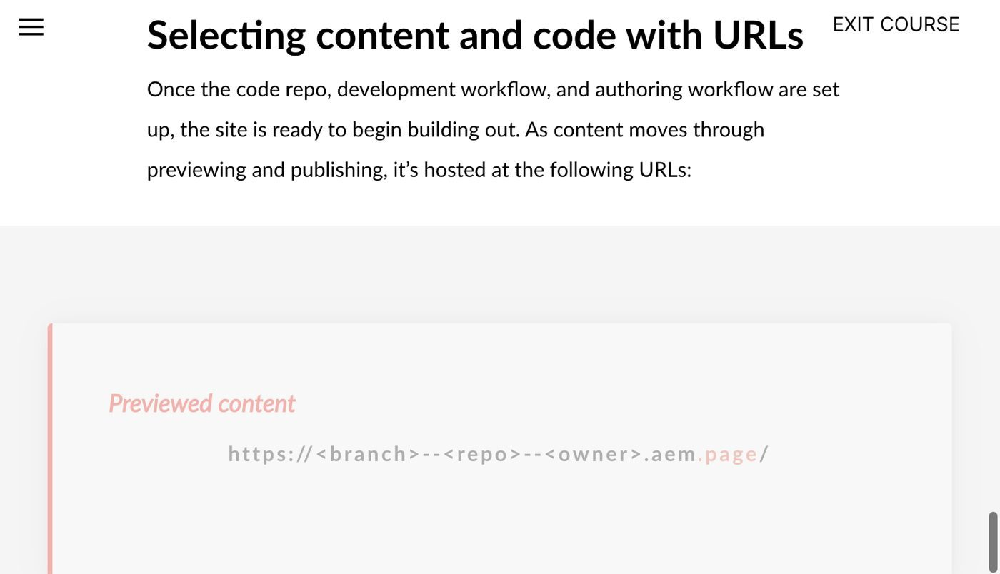{width=70%}
>
> 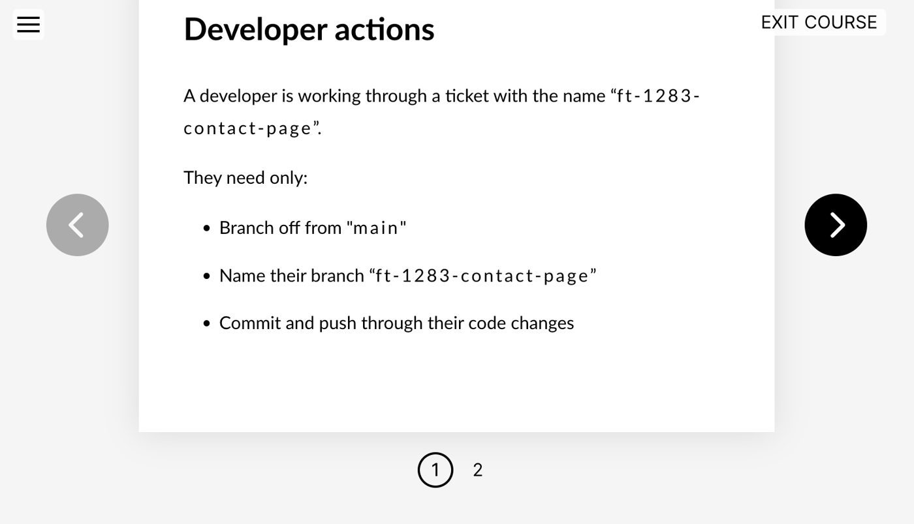{width=70%}

# Step 2: The prompt

Paste the worksheet prompt (deck slide 14) into Claude Code, filling in the brackets:

```
Use the Adobe content-driven-development workflow to improve the selected
block on my imported NORC page.
1. Inspect the existing content, markup, CSS, and JavaScript.
2. Identify whether a boilerplate or Block Collection implementation can be reused.
3. Propose an author-friendly content model with required, optional, and variant fields.
4. Define acceptance criteria before modifying code.
5. After I approve the design, implement the changes using EDS conventions.
6. Preserve content and functionality; do not add unnecessary dependencies.
7. Explain the files changed and how to validate the implementation.

Selected block: cards
Details: norc/index.plain.html uses Cards three times: NORC News (photo optional,
category eyebrow, linked title), NORC in the Media (outlet logo + headline + outlet),
NORC Solutions (linked logo tiles). Logos are cropped by object-fit: cover; cards
without photos look broken; only the title is clickable. Also used on amerispeak/
and amplifyaapi/, so no regressions there.
Do not make code changes until the plan is approved.
```

**Explain why each line matters:**

- **"content-driven-development"** loads Adobe's CDD skill, which forces *content first, code second*.
- **Item 2** makes it check the boilerplate and Block Collection before inventing anything.
- **Item 6** keeps it to plain JS and CSS: no frameworks, no npm packages.
- **"Do not make code changes until the plan is approved"** is the facilitator gate, enforced on the agent.
- **"Details"** should be specific. The more real content you describe, the better the model.

**What the agent reported (worksheet: "summarized the current implementation" and "reuse vs new block"):**

- `blocks/cards/cards.js` is the unchanged **17-line boilerplate**: each row becomes an `<li>`, each cell is classed `cards-card-image` or `cards-card-body`, and images are optimized. It has no handling for missing images, eyebrows or logos.
- `blocks/cards/cards.css` has a single rule for images: `aspect-ratio: 4/3; object-fit: cover`. That's what crops the logos.
- Recommendation: **reuse Cards and add a `logos` variant**. Columns doesn't fit (no repeating items), and there's no Block Collection "logo grid" block. That matches the decision in Exercise 1, Step 5a.

> **📘 Adobe course:** for item 6, Module 2 › Lesson 4 › **Development stack** and Module 4 › *Additional Best Practices* › **JavaScript**.
>
> 🔗 **Lesson:** Module 2 › Lesson 4: Block Development. **Direct link:** https://certification.adobe.com/scorm-data/1343/scormcontent/index.html#/lessons/_dOUOg6VLpUUN-zwi9laYbxho37Nrt4v
> 🔗 **Also:** Module 4 › Additional Best Practices. https://certification.adobe.com/scorm-data/1345/scormcontent/index.html#/lessons/yzfcSloqZm2Y8B2rrt8bFe-HGNfXtkWC
>
> - Module 2 says simple blocks should stay in **plain CSS and JavaScript** for performance. Frameworks (React, Vue, Tailwind…) are only for application-like blocks, and "any framework adds in an additional build step".
> - Module 4 says **"Minimize framework usage"** and **"Keep a web project build-less, unless required."**
> - That's why the prompt says "do not add unnecessary dependencies", and why we check `package.json` at the end (Worksheet fields).
>
> 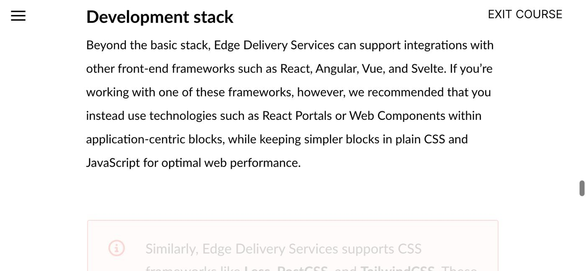{width=70%}
>
> 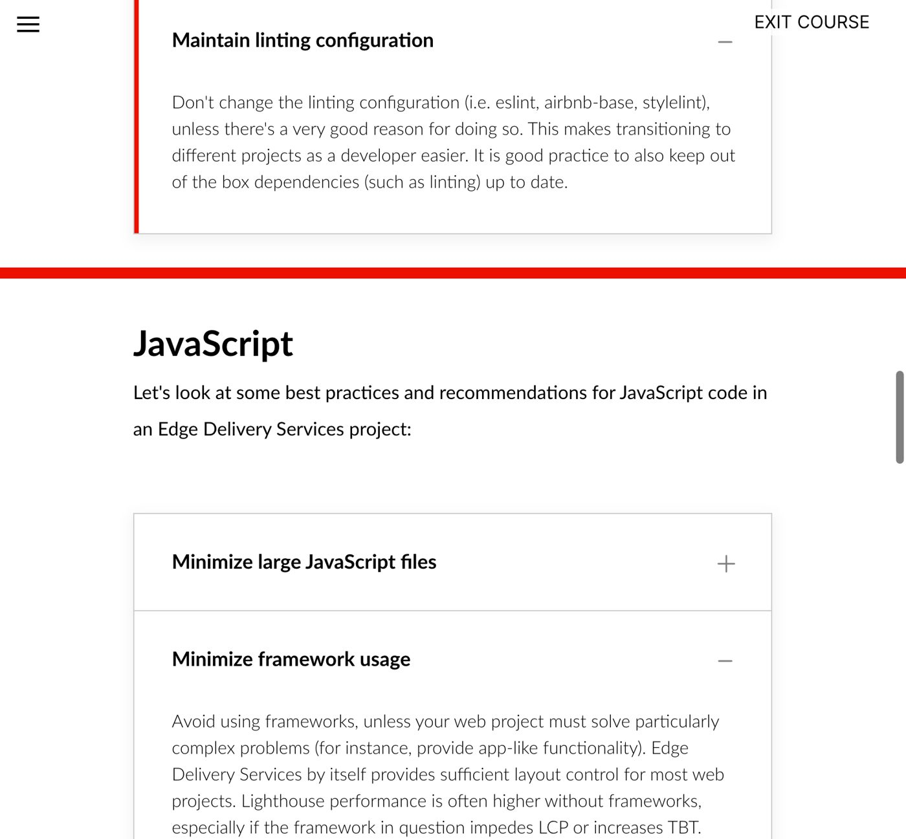{width=70%}

# Step 3: Approve and scope

The agent proposed the same contract as Exercise 1. We approved it with one restriction: **only `blocks/cards/*` and the two table headers in `norc/index.plain.html`**. No other blocks, no global styles, no `scripts/aem.js`, no packages.

> **Say:** "Approval is a scope, not a thumbs-up. I tell the agent exactly which files it may touch."

> **📘 Adobe course:** Module 2 › Lesson 4 › **JavaScript › loadBlock function**, and Module 4 › *Additional Best Practices*.
>
> 🔗 **Lesson:** Module 2 › Lesson 4: Block Development. **Direct link:** https://certification.adobe.com/scorm-data/1343/scormcontent/index.html#/lessons/_dOUOg6VLpUUN-zwi9laYbxho37Nrt4v
> 🔗 **Also:** Module 4 › Additional Best Practices. https://certification.adobe.com/scorm-data/1345/scormcontent/index.html#/lessons/yzfcSloqZm2Y8B2rrt8bFe-HGNfXtkWC
>
> - `aem.js` loads a block's `blocks/<name>/<name>.css` and `.js` (red boxes below), then runs its default export (green box). The course concludes that blocks **"should be modular and self-contained"** and only change the DOM **inside their own container**. So everything we need fits inside `blocks/cards/`.
> - Module 4: **"Do not modify the AEM library with project-specific extensions"** (that's `aem.js`), and **"Keep PRs small and manageable."** One block keeps the PR small.
>
> 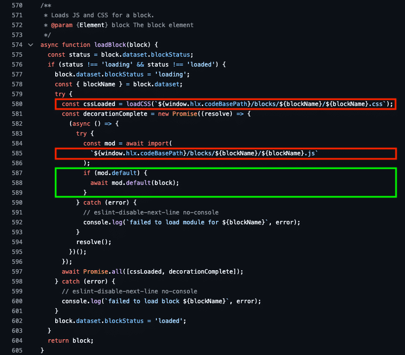{width=70%}

# Step 4: Review the JavaScript change in VS Code

**Do:** compare the original file with the new one: `code --diff <original> blocks/cards/cards.js`.

**Show:**

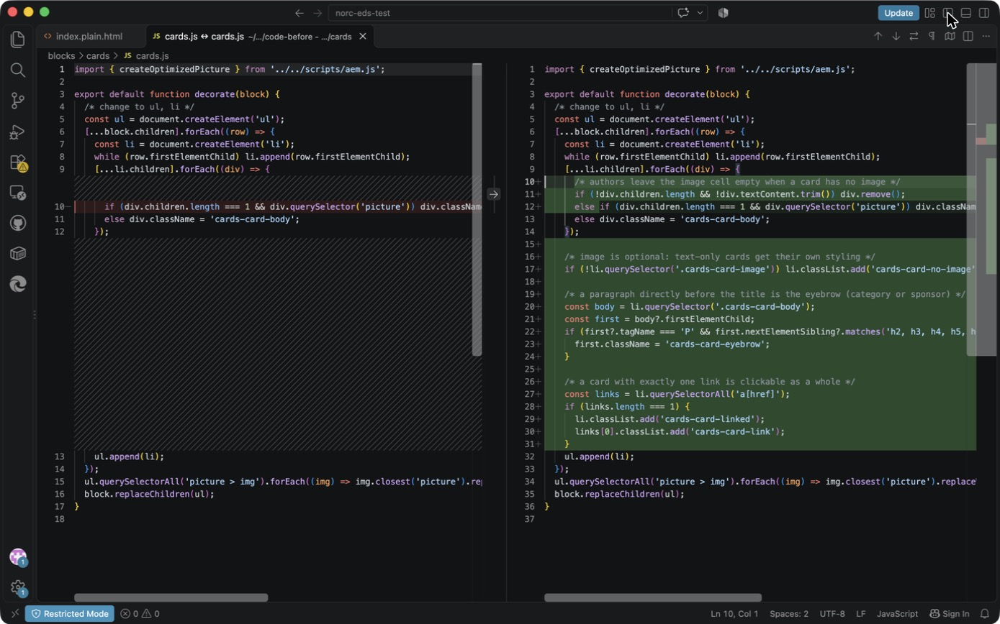{width=100%}

**Walk the green lines top to bottom:**

| Lines (right) | Code | What it does | Why |
|---|---|---|---|
| 10–11 | `if (!div.children.length && !div.textContent.trim()) div.remove();` | Removes an **empty** cell | DA saves a 2-column row even when the author leaves the image cell blank. Found in testing (Exercise 3). |
| 12 | `else if (… picture) …` | Same as before, now an `else` | Keeps the original behavior |
| 16–17 | `if (!li.querySelector('.cards-card-image')) li.classList.add('cards-card-no-image');` | Marks text-only cards | Lets CSS style them deliberately |
| 19–24 | `first?.tagName === 'P' && first.nextElementSibling?.matches('h2…h6')` | A paragraph **directly before** the title becomes the eyebrow | Authors just type a line above the title; no new field |
| 26–31 | `links.length === 1` → `cards-card-linked`, `cards-card-link` | Exactly one link makes the whole card clickable | With 2+ links a whole-card click would be ambiguous, so we don't do it |

> **Say:** "Four small behaviors, about 20 lines, all inside the existing loop. 16 of the original 17 lines are unchanged; the only edit is one `if` that became `else if`. That's why the other sites didn't break."

> **📘 Adobe course:** Module 2 › Lesson 4 › **CSS** and Module 4 › *Additional Best Practices* › **CSS › Simplify CSS with additional elements**.
>
> 🔗 **Lesson:** Module 2 › Lesson 4: Block Development. **Direct link:** https://certification.adobe.com/scorm-data/1343/scormcontent/index.html#/lessons/_dOUOg6VLpUUN-zwi9laYbxho37Nrt4v
> 🔗 **Also:** Module 4 › Additional Best Practices. https://certification.adobe.com/scorm-data/1345/scormcontent/index.html#/lessons/yzfcSloqZm2Y8B2rrt8bFe-HGNfXtkWC
>
> - Module 2: "avoid using complex or brittle CSS selectors… using JavaScript to add classes can help avoid this."
> - Module 4: "Instead of utilizing complex CSS selectors, **decorate additional CSS classes** or elements onto your DOM to write more readable CSS."
> - That's exactly what lines 16–31 do. The JS marks the card (`cards-card-no-image`, `cards-card-eyebrow`, `cards-card-linked`, `cards-card-link`) so the CSS can use simple class selectors instead of guessing structure.
> - Module 4, **Prioritize evergreen browser compatibility**: the course names optional chaining (`?.`, lines 21–22) as a feature to use knowingly. All current evergreen browsers support it, and the boilerplate already needs dynamic `import()`, which is newer.
>
> 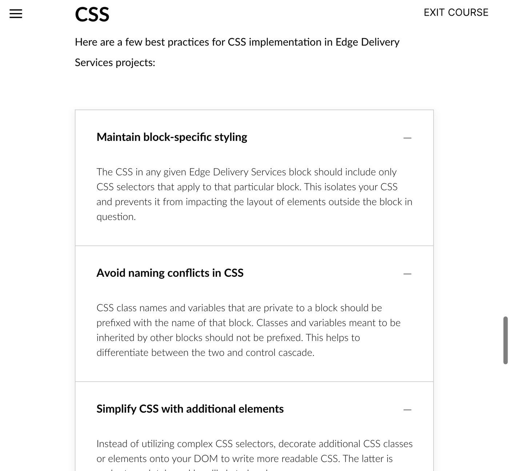{width=70%}

# Step 5: Review the CSS change in VS Code

**Show the eyebrow and title rules:**

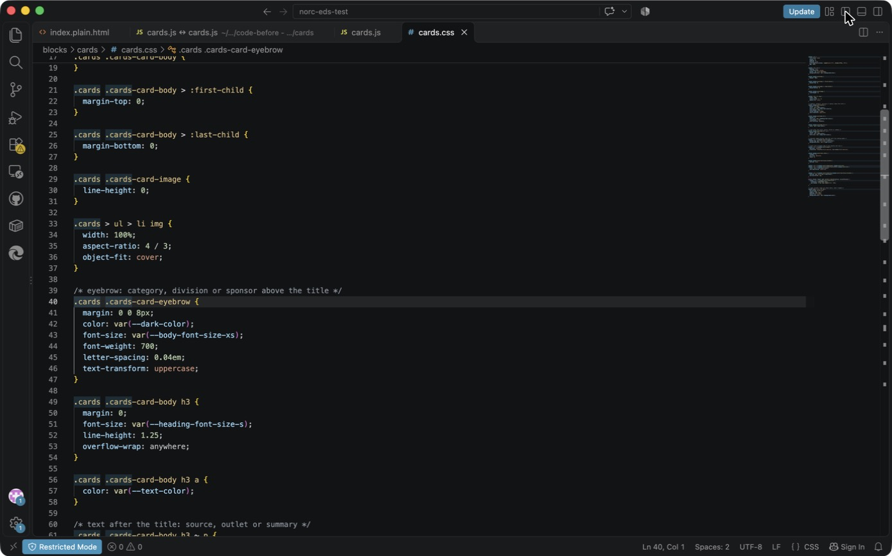{width=100%}

- **Lines 39–47, `.cards-card-eyebrow`:** small, bold, uppercase, grey. Uses the existing tokens `--dark-color` and `--body-font-size-xs`.
- **Lines 49–54, card `h3`:** `--heading-font-size-s` instead of the page-sized `h3`; `overflow-wrap: anywhere` for long words.
- **Lines 56–58:** titles in dark text, like the source site.
- **Lines 60–65, `h3 ~ p`:** the source/outlet/summary line after the title: smaller and grey.

**Show the text-only card and whole-card link rules:**

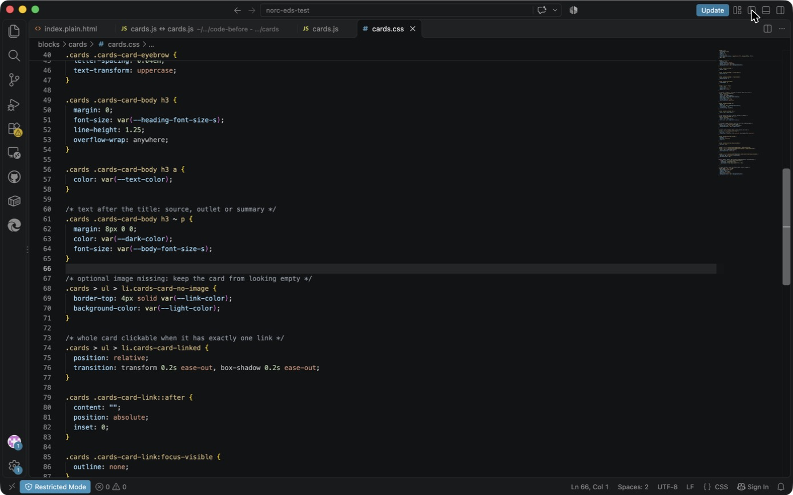{width=100%}

- **Lines 67–71, `li.cards-card-no-image`:** blue top border plus a light background.
- **Lines 73–83, the "stretched link":** the real `<a>` gets an `::after` pseudo-element covering the whole card (`position:absolute; inset:0`). Screen readers still hear **one** link, with the title as its text.
- **Lines 85–87:** the link's own outline is hidden because the **card** shows the focus ring instead (next screenshot).
- **Lines 89–93:** hovering or focusing anywhere on the card underlines the title, so users can see what the click will open.

**Show the focus ring, motion and the variant:**

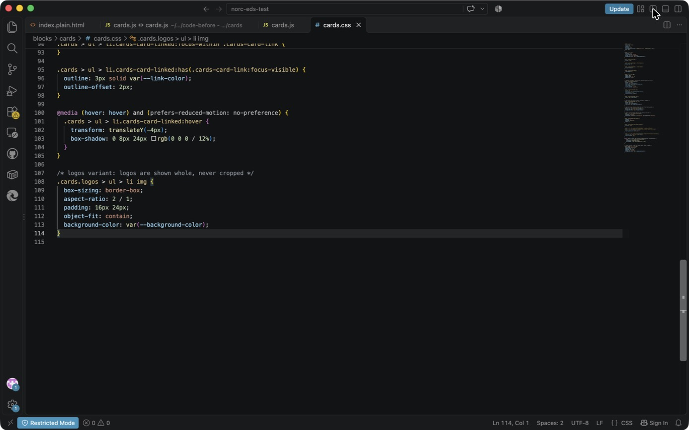{width=100%}

- **Lines 95–98:** `li:has(.cards-card-link:focus-visible)` draws a 3 px ring around the card for keyboard users.
- **Lines 100–105:** the hover lift runs **only** with a mouse (`hover: hover`) **and** when the user hasn't asked for reduced motion. It's transform-only, so it stays smooth.
- **Lines 107–114, `.cards.logos … img`:** **the variant**. `object-fit: contain` in a `2:1` box with padding, so logos are never cropped.

> **Say:** "No new fonts, no libraries, no JavaScript animation. Everything uses the boilerplate's existing color and size tokens, so when NORC's brand styles land, this block follows them."

> **📘 Adobe course:** Module 2 › Lesson 4 › **CSS › The Cards block CSS**, and Module 4 › *Additional Best Practices* › **CSS**. Each rule, checked against our file:
>
> 🔗 **Lesson:** Module 2 › Lesson 4: Block Development. **Direct link:** https://certification.adobe.com/scorm-data/1343/scormcontent/index.html#/lessons/_dOUOg6VLpUUN-zwi9laYbxho37Nrt4v
> 🔗 **Also:** Module 4 › Additional Best Practices. https://certification.adobe.com/scorm-data/1345/scormcontent/index.html#/lessons/yzfcSloqZm2Y8B2rrt8bFe-HGNfXtkWC
>
> | Course rule | Our `cards.css` |
> |---|---|
> | "All block level CSS should be **scoped to the block**… all selectors prefixed with the block class" | All 20 selectors start with `.cards` (or `.cards.logos`) |
> | "Class names… private to a block should be **prefixed with the name of that block**" | `cards-card-eyebrow`, `-no-image`, `-linked`, `-link` |
> | "Keep class names simple" | Plain descriptive names, no namespaces |
> | "Avoid redundant semantic definitions" (ARIA) | No ARIA added; a native `<a>`, `<ul>/<li>` and `<h3>` carry the meaning |
> | "**Mobile first**… your mobile site should render **without media queries**" | Layout is the boilerplate `repeat(auto-fill, minmax(257px, 1fr))` grid: 1 column on phones, more as width grows, with no breakpoints. The only media query is the hover/reduced-motion one. |
> | "Use 600px, 900px and 1200px (all min-width)… Don't combine min-width and max-width" | Not needed here; we added no breakpoints |
>
> 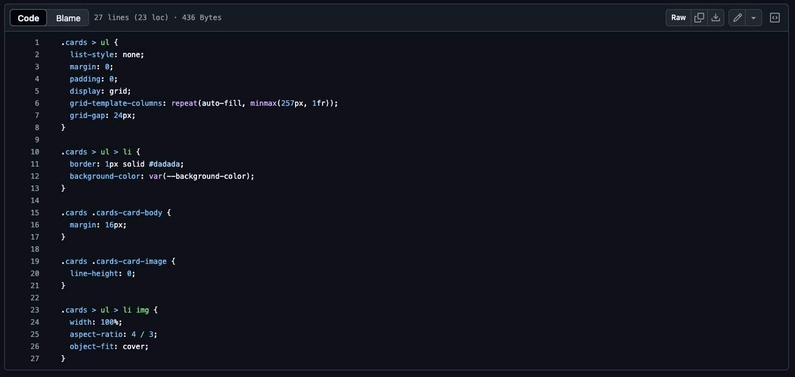{width=80%}
>
> 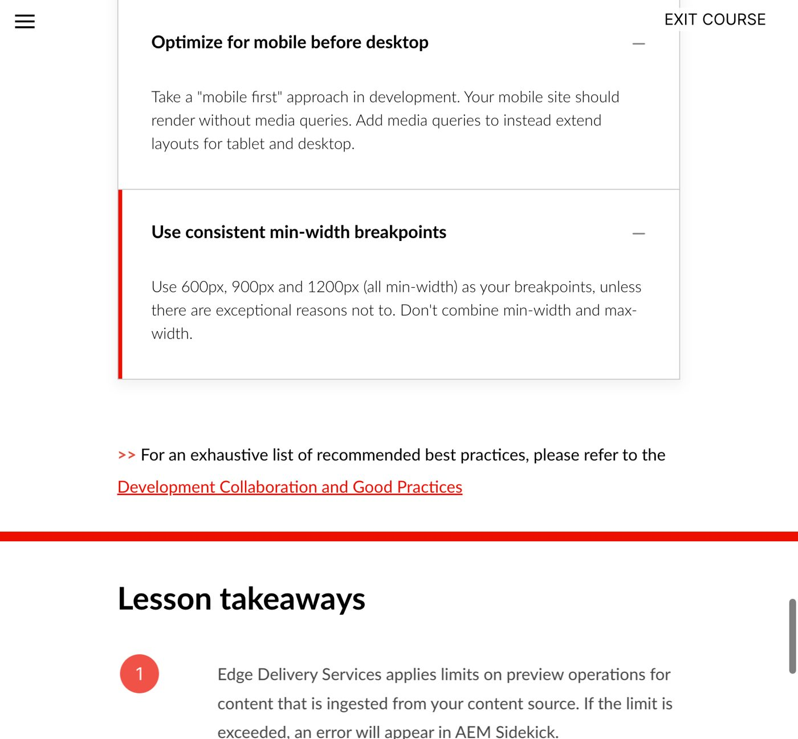{width=70%}

# Step 6: Review the content change

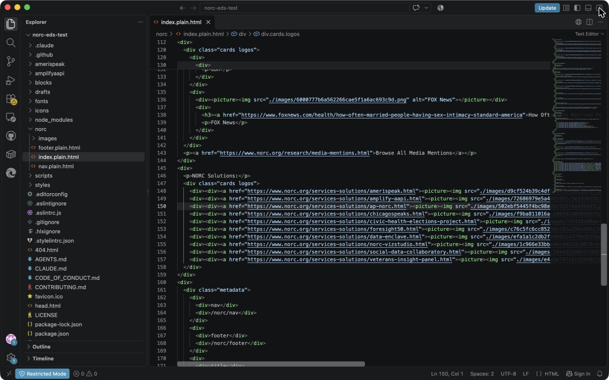{width=100%}

Only `class="cards"` → `class="cards logos"` on lines 120 and 147. In DA that's renaming the table header to **Cards (logos)**. NORC News (line 41) stays plain `cards`.

> **📘 Adobe course:** Module 2 › Lesson 2 › **Block options**: an author writes `Cards (logos)` in the table header and it becomes `class="cards logos"`. This is the same course reference as Exercise 1, Step 5b; now you can see it in the real file.
>
> 🔗 **Lesson:** Module 2 › Lesson 2: Structure of an Edge Delivery Services Page. **Direct link:** https://certification.adobe.com/scorm-data/1343/scormcontent/index.html#/lessons/htUJM8Sej0YW9zDd7aw48vWRqasu9aPJ
>
> 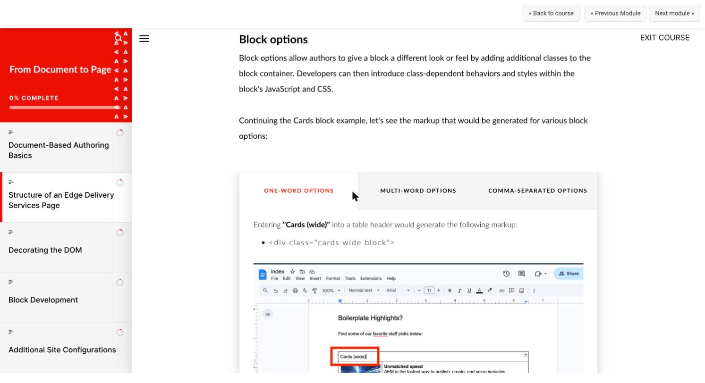{width=70%}

# Worksheet fields: filled in

- ☒ The agent summarized the current implementation (17-line boilerplate; no optional or logo handling)
- ☒ Reviewed reuse vs new block (variant chosen)
- ☒ Approved the model before code changes
- ☒ Implemented the selected block
- ☒ Inspected changed files rather than accepting generated code blindly

**Files changed** (from `git diff --numstat site-folders...cards-refactor`):

| File | Lines | What |
|---|---|---|
| `blocks/cards/cards.js` | +20 −1 | Empty cells, no-image flag, eyebrow, whole-card link |
| `blocks/cards/cards.css` | +87 | Styles for the above, plus the `logos` variant |
| `norc/index.plain.html` | +2 −2 | Two table headers → `cards logos` |

Not changed: `package.json` and `package-lock.json` (no dependencies), `scripts/aem.js`, the lint configuration. The test content `drafts/tmp/cards.plain.html` is local only.

> **📘 Adobe course:** Module 4 › *Additional Best Practices* › **Maintain linting configuration**: "Don't change the linting configuration (eslint, airbnb-base, stylelint) unless there's a very good reason." We didn't, and `npm run lint` passes (Exercise 3).
>
> 🔗 **Lesson:** Module 4 › Additional Best Practices. **Direct link:** https://certification.adobe.com/scorm-data/1345/scormcontent/index.html#/lessons/yzfcSloqZm2Y8B2rrt8bFe-HGNfXtkWC
>
> {width=70%}

**AI suggestions rejected or corrected:**

| What happened | Correction |
|---|---|
| Used the prerequisites' branch name | Too long for EDS; renamed to `cards-refactor` |
| First logo box was 3:2 with 24 px padding (tiny logos in big white tiles) | Tuned to 2:1, `16px 24px` after looking at the screenshot |
| First JS treated an empty image cell as a body | Fixed after the Exercise 3 test |
| Worksheet Lab 6 says `git add .` | Rejected; see Exercise 4 |

# Questions you may get

- **"Why `:has()`?"** It lets the card show focus when its link is focused, with no JS. It's supported in all current browsers (the course's "evergreen browser" rule).
- **"Why not wrap the whole card in `<a>`?"** A link containing a heading, an image and more text is read out as one long link name, and it breaks when a card has two links.
- **"Did it add dependencies?"** No. `package.json` is unchanged.
- **"Why not edit `aem.js` or `styles.css`?"** The course says block code stays in the block and the AEM library isn't changed for project needs. A global change would also affect every block on every site in this repo.
