# What this exercise is for

**Goal:** test **content variability**, not only "does it look like the screenshot". Prove the block survives what real authors will do.

**Output:** a filled test table, evidence (screenshots), and **at least one issue found and corrected**.

> **Say:** "The original page passes, but that's the easy case. Authors will leave out images, write long titles, add one card or ten. That's what we test."

**When:** the facilitator notes say **"At minute 85, shift everyone to validation; limit optional enhancements."** Whatever isn't finished by then becomes a known limitation in the PR, not more code.

| Deck slide 16 item | Where it is covered |
|---|---|
| Original imported data | Scenario 1, Step 3 (before/after on `/norc/`) |
| No image / no CTA | Scenarios 2, 2b (no image), 3 (no link = no CTA) |
| Long title or description | Scenario 4 |
| One and multiple entries | Scenario 5 (one); 6 and 10 cards on `/norc/` (multiple) |
| Desktop + mobile | Step 4, Desktop and mobile |
| Alt text and semantics | Step 4, Keyboard, semantics and alt text; Lighthouse |
| Keyboard operation as needed | Step 4, focus ring screenshot |
| Console and network errors | Step 4, Console and network errors |
| **"Capture at least one issue found and corrected"** | Scenario 2b, plus "Defects found and corrected" |

| Worksheet Lab 5 | Where it is covered |
|---|---|
| "Start/keep the server running with aem up and use browser DevTools" | Step 1 (server on port 3006); Step 4 (DevTools device toolbar, Console, Lighthouse) |
| "Source content plus at least two alternate content scenarios" | Scenario 1 + 8 alternates (2–7) |
| Test table (6 rows) and "Defects found and corrected" | "Worksheet test table: filled in" |

## Adobe certification course reference

| | Link (Adobe ID sign-in needed for the course) |
|---|---|
| Course home | https://certification.adobe.com/courses/1308 |
| Module 3: Setting Up (AEM CLI, local testing) | https://certification.adobe.com/courses/playScorm/1395/1308 |
| Module 4: Optimizing Content Delivery (PageSpeed Insights; Performance Optimization Techniques › Block testing) | https://certification.adobe.com/courses/playScorm/1345/1308 |
| Module 5: Launching Your Website (Go-Live Checklist › Content and design QA) | https://certification.adobe.com/courses/playScorm/1346/1308 |


*Verified: every module link above appears on the course home page (catalog ID EDS-D200), and every 🔗 lesson link below opens the named lesson inside that module. Module links need an Adobe ID sign-in; the direct lesson links open without one.*

# Step 1: Build a test page from real content

**Do:** create `drafts/tmp/cards.plain.html` with one section per scenario, using real NORC News, Media and Solutions content (the CDD skill's "local HTML" approach). It's served at **http://localhost:3006/drafts/tmp/cards**.

**Show it in VS Code:**

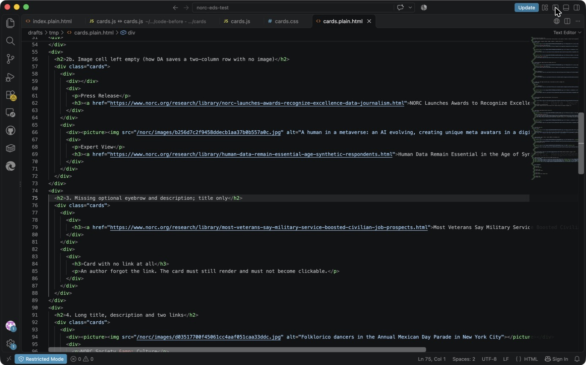{width=100%}

**Point at:**

- **Line 59, `<div></div>`:** an image cell left empty. This is how DA saves a 2-column row with no image.
- **Lines 83–85:** a card with **no link**. It must render and must *not* become clickable.

> **Say:** "This file is our test harness. It isn't committed; it only lives on my machine."

> **📘 Adobe course:** Module 4 › *Performance Optimization Techniques* › **Block testing**.
>
> 🔗 **Lesson:** Module 4 › Performance Optimization Techniques. **Direct link:** https://certification.adobe.com/scorm-data/1345/scormcontent/index.html#/lessons/OTt279XR69CtYDWVrFSDTKaYhdLF8uAv
> 🔗 **Also:** Module 3 › Initial Setup and Configuration. https://certification.adobe.com/scorm-data/1395/scormcontent/index.html#/lessons/mopjdHluFIPYbbWleIqmjkXQPJHYN01L
>
> - The course's method: build a **test page that contains the block** and test it, thinking about "not only what content has been added to that test page but also the order of it."
> - Its example puts a new Scoreboard block on a test page (below). Its PR example tests a page at **`/drafts/video`**, the same `drafts/` convention as our `drafts/tmp/cards`.
> - Module 3 › *AEM CLI*: you test locally with `aem up` **before** pushing a branch for others.
>
> 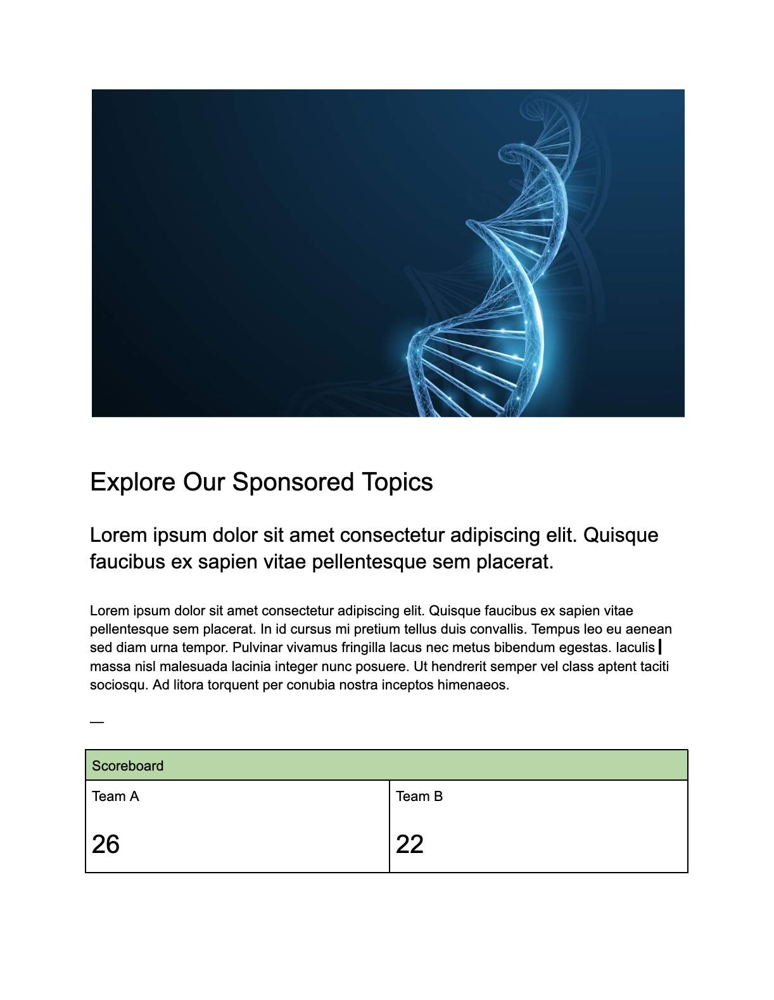{width=45%}

# Step 2: Run each scenario

## Scenario 1: Original imported content

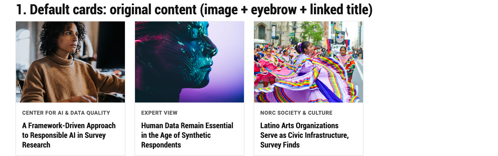{width=100%}

**Check:** the eyebrow is small and uppercase, titles are consistent, the whole card is clickable. **Pass.**

## Scenario 2: Missing optional image

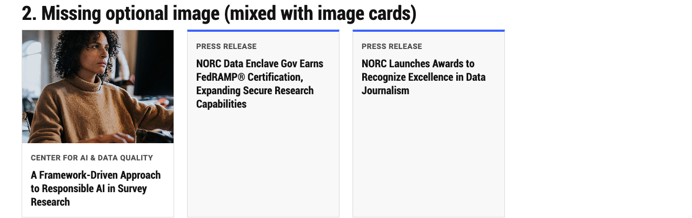{width=100%}

**Check:** text-only cards have a blue accent and light background, so they look intentional. **Pass.**

## Scenario 2b: Image cell left empty. **The defect we found.**

**Before the fix:** the empty cell became an empty card body. That added a blank gap at the top **and** hid the eyebrow, because the code looked for it in the first (empty) body.

{width=100%}

**Fix:** one line in `cards.js` removes empty cells before anything else (diff lines 10–11):

```js
if (!div.children.length && !div.textContent.trim()) div.remove();
```

**After the fix:**

{width=100%}

> **Say:** "This is exactly why the deck says *'Capture at least one issue found and corrected.'* The original page never had an empty cell, so we'd never have seen this without a test scenario."

## Scenario 3: No eyebrow, no description, no link

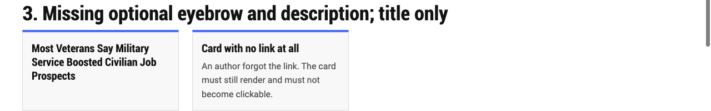{width=100%}

**Check:** both render; the card with no link has no hover and isn't clickable. **Pass.**

## Scenario 4: Long title, description and two links

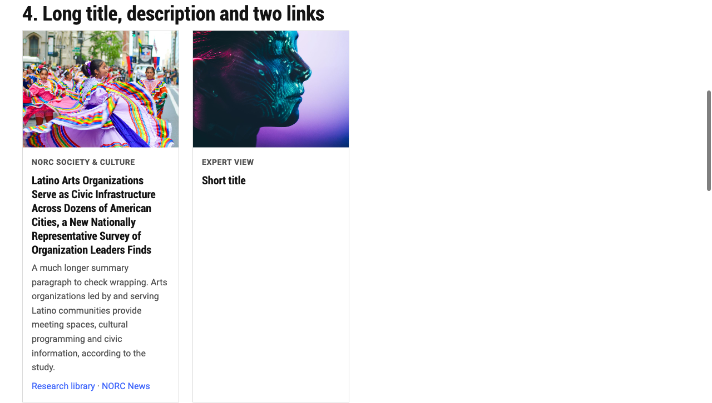{width=100%}

**Check:** the text wraps cleanly with no overflow. Because there are **two** links, the card isn't clickable as a whole, and each link works on its own. **Pass.**

## Scenario 5: One entry only

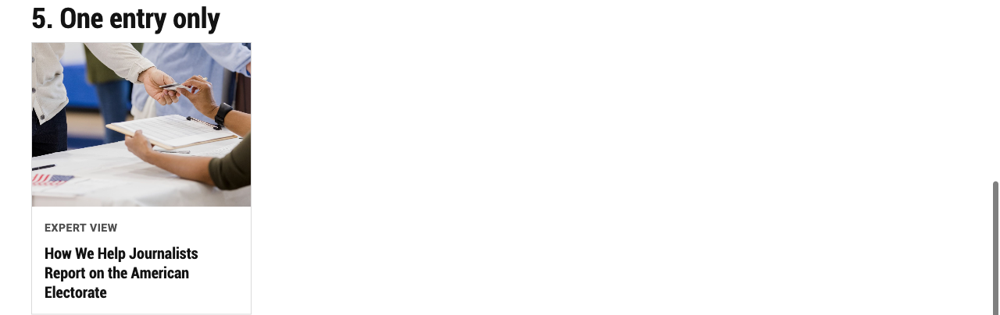{width=100%}

**Pass.**

## Scenario 6: Logos variant with text (NORC in the Media)

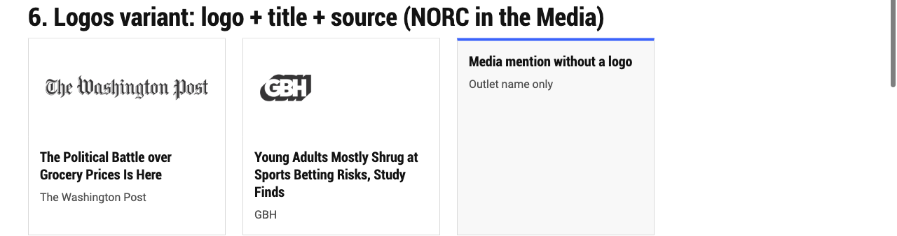{width=100%}

**Check:** the Washington Post and GBH logos are whole. A card without a logo falls back to the text-only style. **Pass.**

## Scenario 7: Logos variant, tiles only (NORC Solutions)

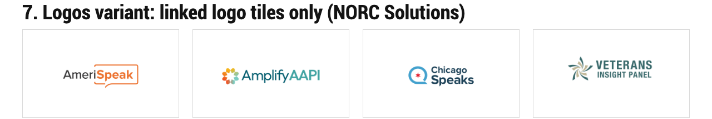{width=100%}

**Pass.** (The 4th tile has no link on purpose; it isn't clickable.)

# Step 3: The real page, before vs after

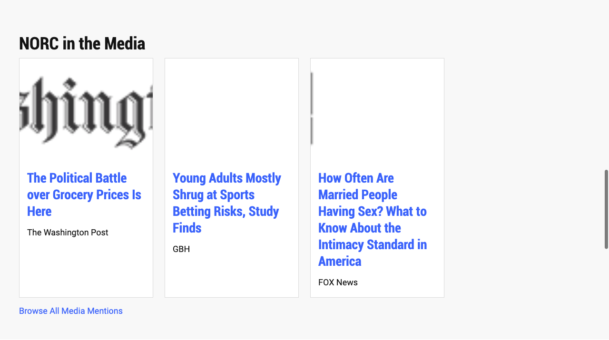{width=100%}

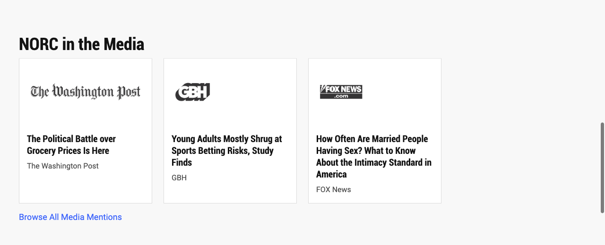{width=100%}

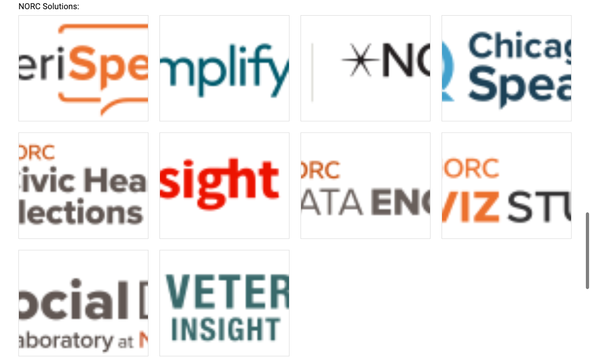{width=100%}

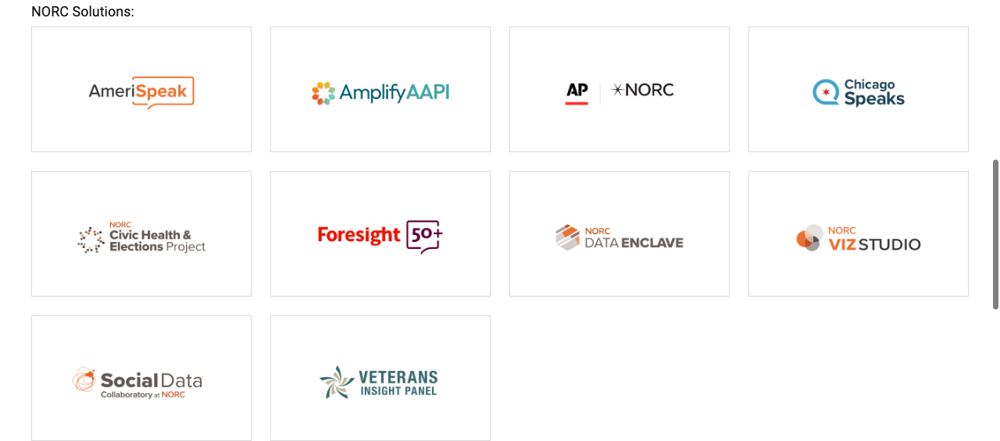{width=100%}

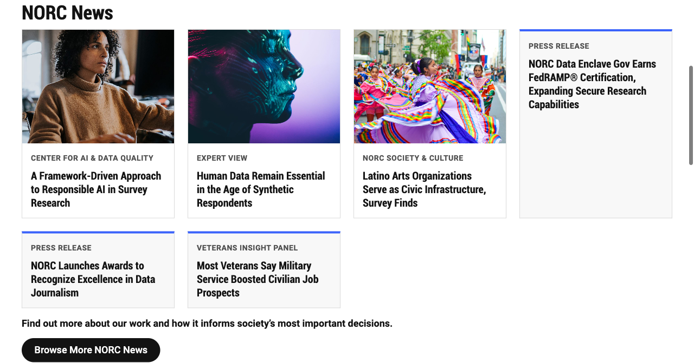{width=100%}

# Step 4: Quality checks

## Desktop and mobile

**Do:** set the browser width to 375 px (DevTools device toolbar → iPhone).

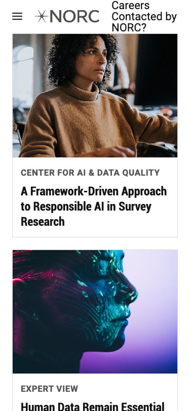{width=40%} 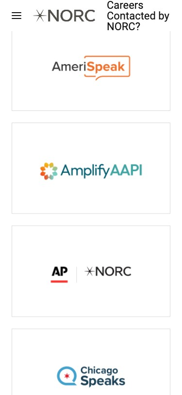{width=40%}

**Check:** one column, and the page is exactly 375 px wide (`document.documentElement.scrollWidth === 375`), so there's no horizontal scroll. **Pass.**

> **📘 Adobe course:** Module 4 › *Additional Best Practices* › **Optimize for mobile before desktop**: "Your mobile site should render without media queries." Our Cards grid has no breakpoints; it goes from 1 column (375 px) to 2 (768 px) to 4 (1200 px) on its own. Module 5 › *Go-Live Checklist* › **Content and design QA**: "Confirm that the design renders correctly across various browsers and devices."
>
> 🔗 **Lesson:** Module 4 › Additional Best Practices. **Direct link:** https://certification.adobe.com/scorm-data/1345/scormcontent/index.html#/lessons/yzfcSloqZm2Y8B2rrt8bFe-HGNfXtkWC
> 🔗 **Also:** Module 5 › Go-Live Checklist. https://certification.adobe.com/scorm-data/1346/scormcontent/index.html#/lessons/tVlzeBUh57XSCsowBwLysj3lGB39YFkl
>
> 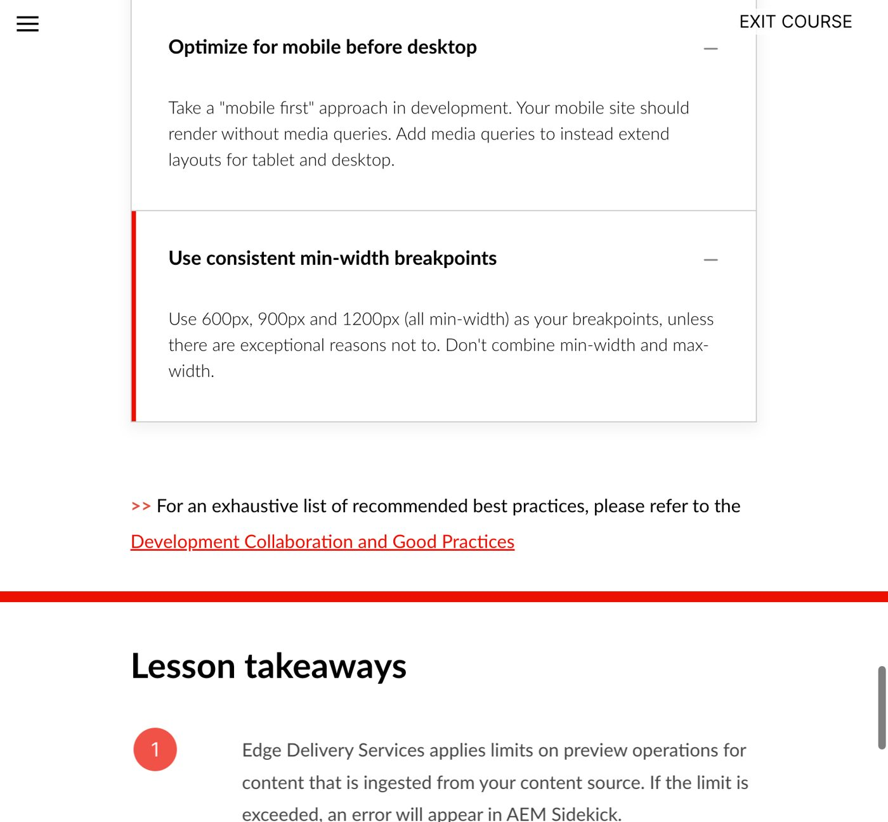{width=70%}

## Keyboard, semantics and alt text

**Do:** press **Tab** until you reach a card.

{width=100%}

**Check:**

- Cards are a `<ul>` of `<li>`, and titles stay `<h3>`.
- Every image keeps its alt text.
- Focus is visible on the whole card.
- **Pass.**

> **📘 Adobe course:** Module 4 › *PageSpeed Insights* › **Accessibility**: "Lighthouse examines **alt text and keyboard navigation** support", and an audit fails if even 1 of 10 images lacks alt text. The course's screenshot shows the two checks we did by hand: "Interactive controls are keyboard focusable" and "Image elements have [alt] attributes". Module 5 › *Content and design QA*: "Verify accessibility… appropriate alt text for images, and proper use of header tags."
>
> 🔗 **Lesson:** Module 4 › PageSpeed Insights. **Direct link:** https://certification.adobe.com/scorm-data/1345/scormcontent/index.html#/lessons/5bMlTz-yUMoxyiXU9fAhGqsDQKm2I7Ea
> 🔗 **Also:** Module 5 › Go-Live Checklist. https://certification.adobe.com/scorm-data/1346/scormcontent/index.html#/lessons/tVlzeBUh57XSCsowBwLysj3lGB39YFkl
>
> 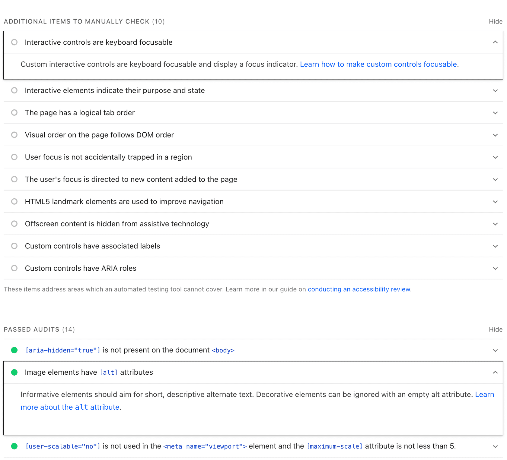{width=70%}

## Lighthouse (accessibility, best practices, SEO)

**Do:** DevTools → Lighthouse on `http://localhost:3006/drafts/tmp/cards`, mobile and desktop.

| Category | Mobile | Desktop | What failed | Inside Cards? |
|---|---|---|---|---|
| Accessibility | 95 | 95 | `target-size`: small header/footer links ("Careers", footer lists, social icons) | **No.** All 15 flagged links are in `<header>` / `<footer>` |
| Best Practices | 96 | 96 | `doctype`: the local server couldn't load `head.html` (404 from the `main` proxy) | **No.** It's a local-setup issue |
| SEO | 63 | 63 | `is-crawlable`: `<meta name="robots" content="noindex">` | **No.** Preview pages are noindex on purpose |

**Result:** 0 Lighthouse failures inside the Cards block. **Pass** for the block. The header/footer touch targets go under "Known limitations", for the header/footer owner.

> **Say:** "Lighthouse is where the course wants a 100. Our block adds no failures. What's red belongs to the header, the footer and the local setup, and we write that down instead of hiding it."

> **📘 Adobe course:** Module 4 › *Block testing*: "**thoroughly test new code changes against PageSpeed Insights before merging**." Module 5 › *Performance validation*: aim for 100 on mobile and desktop (90+ may be acceptable). Module 5 › *Sitemap and robots*: "keep aem.page and aem.live hidden from crawlers… done by default", which explains the SEO 63.
>
> 🔗 **Lesson:** Module 4 › Performance Optimization Techniques. **Direct link:** https://certification.adobe.com/scorm-data/1345/scormcontent/index.html#/lessons/OTt279XR69CtYDWVrFSDTKaYhdLF8uAv
> 🔗 **Also:** Module 5 › Go-Live Checklist. https://certification.adobe.com/scorm-data/1346/scormcontent/index.html#/lessons/tVlzeBUh57XSCsowBwLysj3lGB39YFkl
>
> **Gap to state honestly:** the **Performance** score needs PageSpeed Insights on a public `.aem.live` URL. This repo's preview URLs return 404 today (see Exercise 4, Step 4), so performance is checked when the PR's preview works. Until then it's a next step in the PR.
>
> 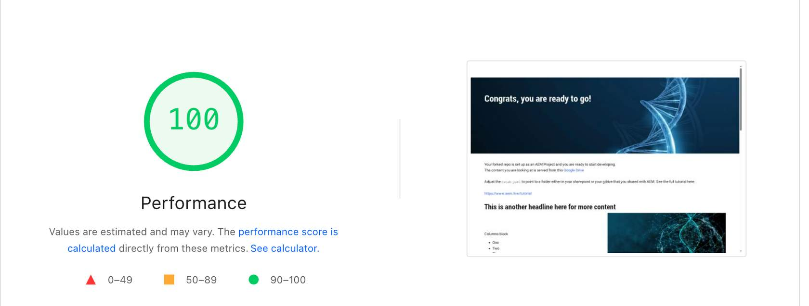{width=70%}

## Console and network errors

**Do:** open DevTools → Console on the test page.

**Check:**

- **0 errors, 0 warnings** on the test page.
- On `/norc/`, the only messages are the 3 that were there before: `placeholders.json` 404 and `section-metadata.css` 404 (twice). Neither is related to Cards.
- **Pass.**

## Regression: other sites that use Cards

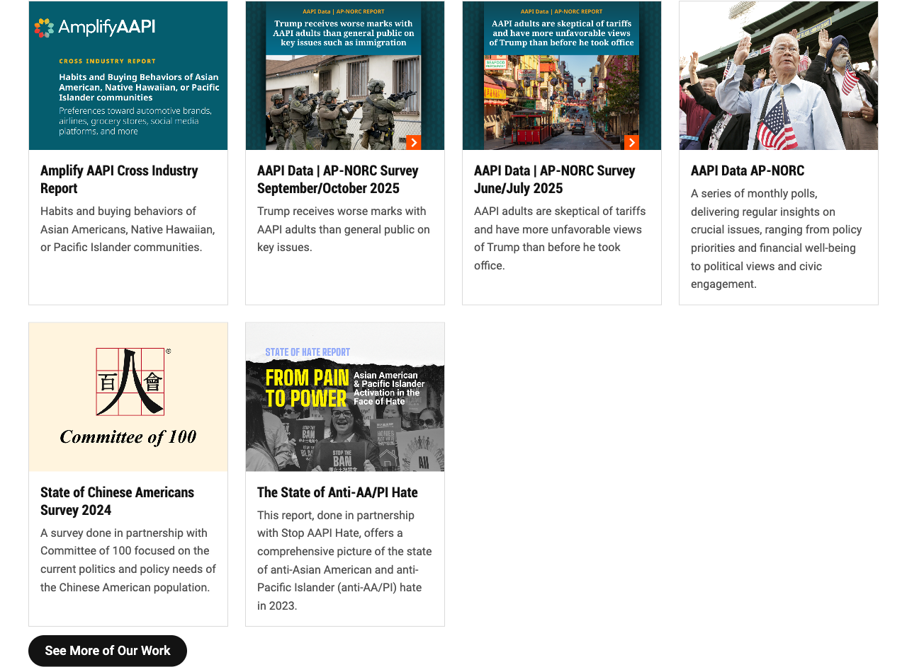{width=100%}

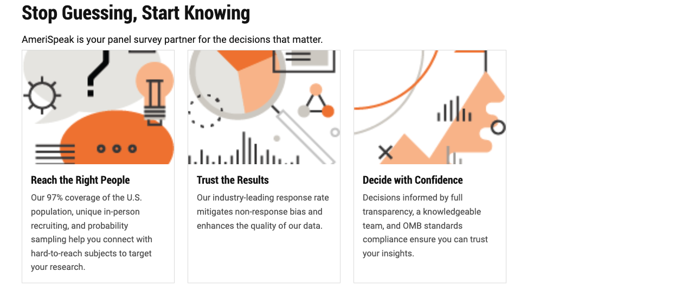{width=100%}

**Pass:** all blocks loaded and no broken images.

> **📘 Adobe course:** Module 4 › *Block testing*: "be mindful of its different possible configurations to ensure the block does not degrade… regardless of where or how it is placed on a page." Other sites using Cards are those other configurations.
>
> 🔗 **Lesson:** Module 4 › Performance Optimization Techniques. **Direct link:** https://certification.adobe.com/scorm-data/1345/scormcontent/index.html#/lessons/OTt279XR69CtYDWVrFSDTKaYhdLF8uAv
>
> 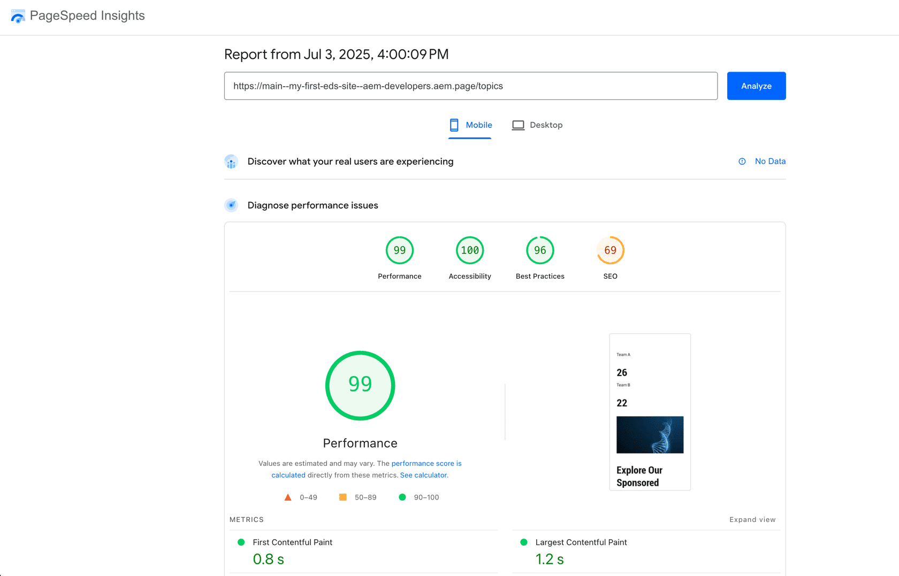{width=70%}

## Lint

```bash
npm run lint
```

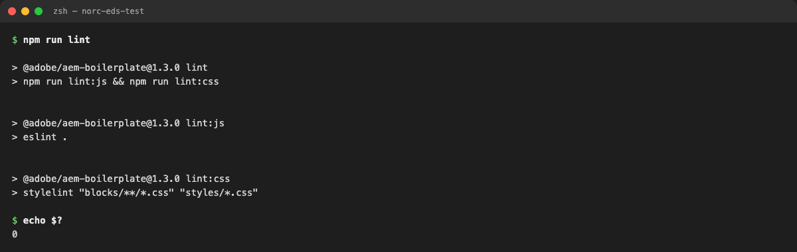{width=100%}

Re-checked for this doc: `npm run lint` exits with code 0 on `cards-refactor`.

> **📘 Adobe course:** Module 4 › *Additional Best Practices* › **Meet linting and Lighthouse standards**: "Don't submit a PR that has linting errors or a low Lighthouse score… these are minimum criteria."
>
> 🔗 **Lesson:** Module 4 › Additional Best Practices. **Direct link:** https://certification.adobe.com/scorm-data/1345/scormcontent/index.html#/lessons/yzfcSloqZm2Y8B2rrt8bFe-HGNfXtkWC
>
> 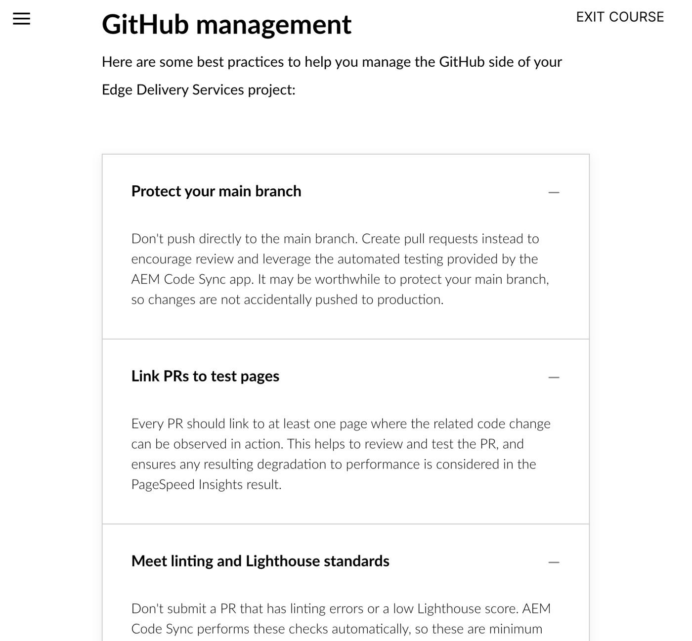{width=70%}

# Worksheet test table: filled in

| Test scenario | Pass / fail | Notes / screenshot |
|---|---|---|
| Original imported content | ☒ Pass | Scenario 1; `/norc/` 5/5 blocks loaded, 20 images, 0 broken |
| Missing optional image/description | ☒ Pass | Scenarios 2, 2b (after the fix), 3 |
| Long title or extra item | ☒ Pass | Scenario 4; 6 and 10 items on `/norc/` |
| Desktop and mobile | ☒ Pass | 1280 / 375 px, no horizontal scroll |
| Keyboard / semantics / alt text | ☒ Pass | Focus ring on the card; `ul/li/h3`; all alt kept; Lighthouse: 0 failures in Cards |
| Console / network errors | ☒ Pass | 0 new; 3 that were already there and unrelated |

**Defects found and corrected:**

1. An empty image cell left a blank gap and hid the eyebrow. Fixed in `cards.js` (one line).
2. Logo tiles had too much white space at 3:2. Changed to 2:1.
3. The branch name was over the 63-character limit and stopped the server. Renamed (see Exercise 2).

# Questions you may get

- **"Isn't a local HTML test page cheating?"** It's the CDD skill's documented approach when there's no CMS content yet. Before the PR is final, the same content should be created in DA so reviewers get a preview link.
- **"How do you know the mobile check passed and didn't just look fine?"** We measured `scrollWidth` = 375.
- **"Accessibility is 95, not 100. Did we break something?"** No. Every failing node is in the header or footer, which this change doesn't touch. We list it as a known limitation so it isn't lost.
