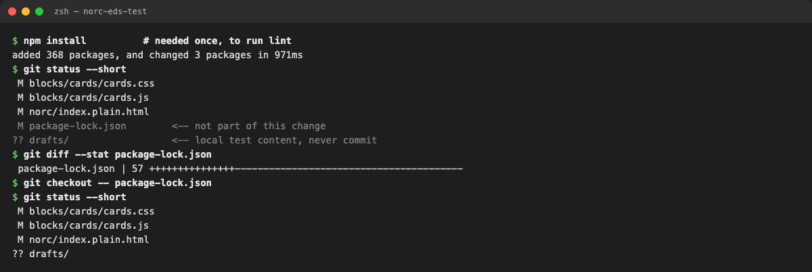
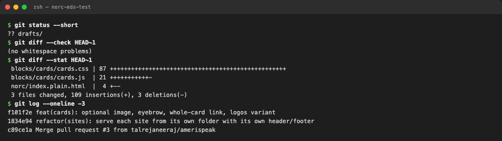
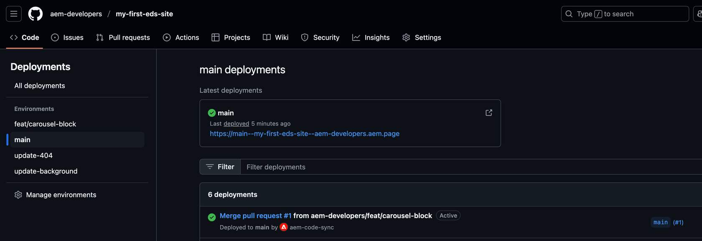
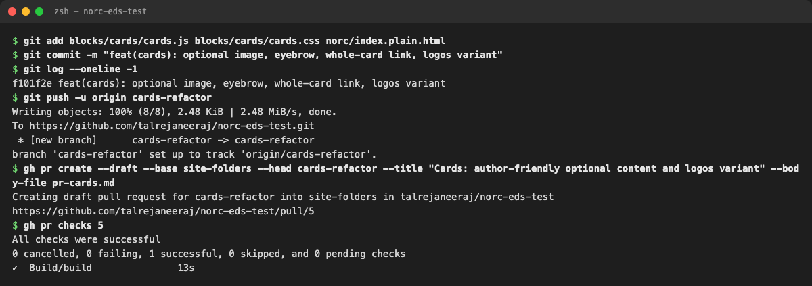
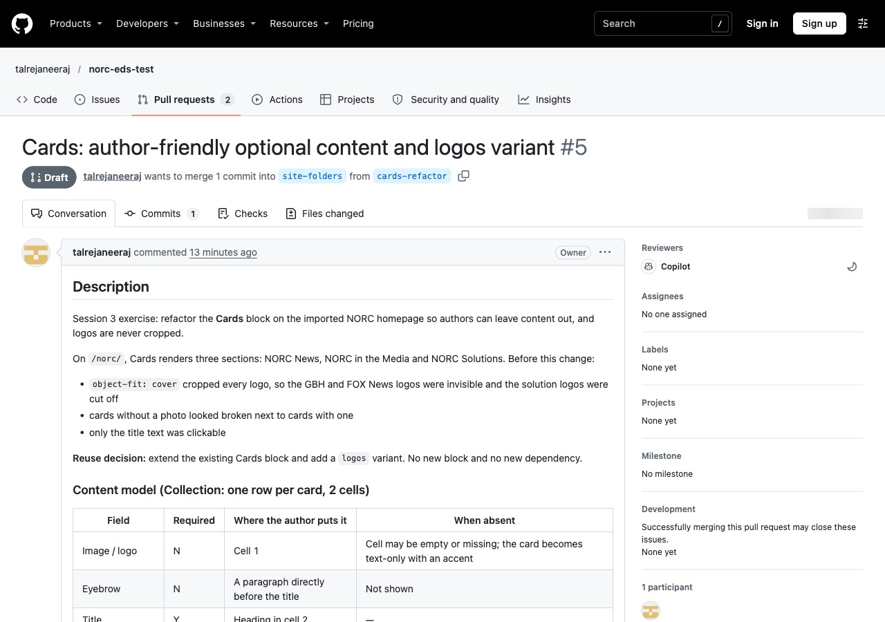
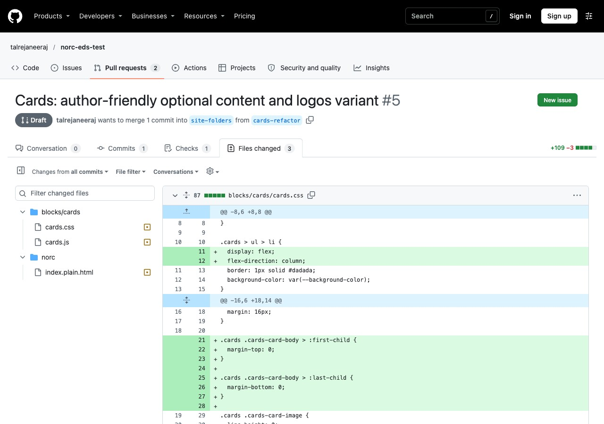
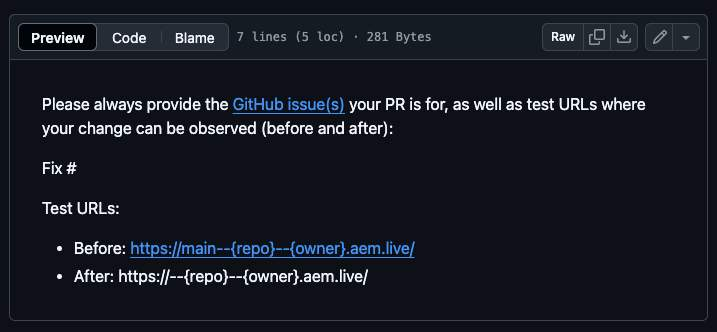
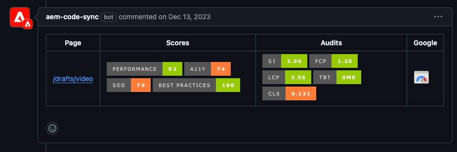
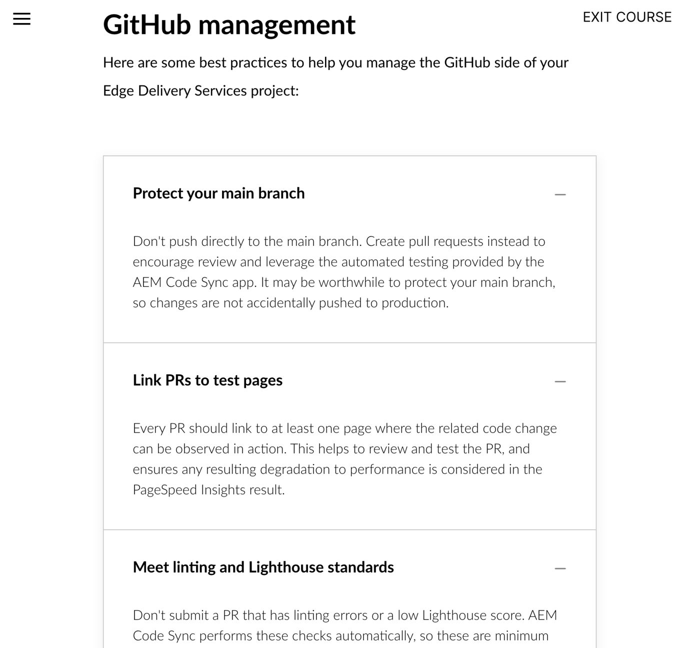
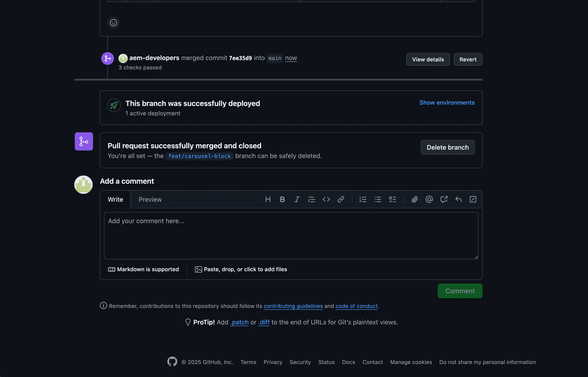

# What this exercise is for

**Goal:** review the change the way a reviewer would, commit only what belongs, and open a PR that someone else can validate.

**Output:** a clean commit on a feature branch and a PR with the content model, screenshots, test evidence and limitations.

> **Say:** "Git is where a good change becomes a reviewable change. The two traps here are committing too much and describing too little."

| Deck slide 17 / worksheet Lab 6 | Where it is covered |
|---|---|
| `git status`, `git diff --check`, `git diff --stat`, `git diff` | Steps 1–2 |
| `git add .` → commit → `git push -u origin <branch>` | Step 3 (with one correction: stage by file name) |
| "Open a PR with the content model, screenshots, test evidence and limitations" | Step 4 |
| ☐ Diff contains only intended files | Step 1, Step 2 checklist |
| ☐ No hardcoded secrets, local paths, or unnecessary packages | Step 2 checklist (with the checks we ran) |
| ☐ Content model and test results documented in PR description | Step 4 |
| ☐ Feature branch pushed and PR created (stretch goal) | Steps 3–4 |
| Branch / Commit / PR URL fields | "Worksheet fields: filled in" |
| Final deliverables (6 items) and slide 18 Definition of done | "Definition of done" |
| Retrospective (4 questions) | "Retrospective answers" |

## Adobe certification course reference

| | Link (Adobe ID sign-in needed for the course) |
|---|---|
| Course home | https://certification.adobe.com/courses/1308 |
| Module 3: Setting Up (Authoring and Development Flows › Development workflow; AEM Code Sync) | https://certification.adobe.com/courses/playScorm/1395/1308 |
| Module 4: Optimizing Content Delivery (Performance Optimization Techniques › Automated PR testing; Additional Best Practices › GitHub management) | https://certification.adobe.com/courses/playScorm/1345/1308 |


*Verified: every module link above appears on the course home page (catalog ID EDS-D200), and every 🔗 lesson link below opens the named lesson inside that module. Module links need an Adobe ID sign-in; the direct lesson links open without one.*

# Step 1: Review the working tree, and catch what doesn't belong

**Show what `git status` looked like right after running lint:**

{width=100%}

**Explain:**

- `package-lock.json` changed because `npm install` (needed to run lint) rewrote it. **It isn't part of this change**, so we reverted it with `git checkout -- package-lock.json`.
- `drafts/` is our local test page. **It never gets committed.**
- That leaves exactly the 3 intended files.

> **Say:** "This is why the worksheet's `git add .` is dangerous. It would have committed both of these."

# Step 2: Run the worksheet's review commands

```bash
git status
git diff --check
git diff --stat
git diff
```

**Show (after the commit, comparing with the previous commit):**

{width=100%}

**Explain:**

- `git diff --check` reports **no whitespace problems**.
- `git diff --stat` shows **3 files, +109 / −3**, which matches what we reviewed in VS Code in Exercise 2.
- `git diff` is the full line-by-line review. Do it in VS Code's diff view; it's easier to read.

**Review checklist:**

- ☒ The diff contains only the intended files
- ☒ No hard-coded secrets, local paths (`/Users/...`) or unnecessary packages
- ☒ Content model and test results go in the PR description
- ☒ Feature branch pushed and PR created (stretch goal)

**How each item was checked** (so you can say "we checked", not "we looked"):

| Item | Check | Result |
|---|---|---|
| Only intended files | `git diff --stat site-folders...cards-refactor` | 3 files: `cards.js`, `cards.css`, `norc/index.plain.html` |
| No local paths | search the diff for `/Users/` and `localhost` | none |
| No secrets | search the diff for `token`, `key`, `password`, `secret` | none |
| No unnecessary packages | `git diff … -- package.json package-lock.json` | empty (no changes) |
| Nothing untracked slipped in | `git status` | only `drafts/` untracked, never staged |

> **📘 Adobe course:** Module 3 › *Development workflow*: when code is pushed to GitHub, the **AEM Code Sync** app copies it to the Code Bus, and every branch is served at its own `aem.page` / `aem.live` URL. In other words, **anything you commit gets published to a URL**. That's why local paths, secrets and test files must never be committed.
>
> 🔗 **Lesson:** Module 3 › Authoring and Development Flows. **Direct link:** https://certification.adobe.com/scorm-data/1395/scormcontent/index.html#/lessons/0UYSnsREq1kk5ZfsNxKQNonsAy0pDaOG
>
> {width=70%}

# Step 3: Commit and push

**One correction to the worksheet:** stage files **by name**. The Adobe CDD skill says *"NEVER use `git add .`"*

```bash
git add blocks/cards/cards.js blocks/cards/cards.css norc/index.plain.html
git commit        # message below
git push -u origin cards-refactor
```

**Commit message** (conventional-commit format: what changed, then why):

```
feat(cards): optional image, eyebrow, whole-card link, logos variant

- Remove empty cells so a blank image cell does not leave a gap
- Style text-only cards; mark the paragraph before the title as an eyebrow
- Make a card with exactly one link clickable as a whole (stretched link,
  visible focus ring, hover lift gated by prefers-reduced-motion)
- Add the logos variant: logos are contained, never cropped
- Use Cards (logos) for NORC in the Media and NORC Solutions
```

**Show the real output:**

{width=100%}

**Explain:**

- The commit is **one logical change** to one block. Module 4 says **"Keep PRs small and manageable"**: "small and short-lived… reduces the effort and complexity to review."
- The push goes over **HTTPS** to `talrejaneeraj`. No SSH, no other account.
- The PR is a **draft** because its preview links can't render yet (see the gap in Step 4). The CDD skill says to open a draft in that case.
- Its base is **`site-folders`**, not `main`, because this branch builds on PR #4. That keeps the PR to just our 3 files. Merge #4 first.

# Step 4: The pull request

**Show:** https://github.com/talrejaneeraj/norc-eds-test/pull/5

{width=100%}

**Walk the PR description** (slide 17: *"content model, screenshots, test evidence and limitations"*):

1. **Description:** what was broken and the reuse decision.
2. **Content model:** the field table from Exercise 1.
3. **Changes:** one bullet per file.
4. **Test:** the scenario table from Exercise 3, plus before/after preview URLs:
   - `https://main--norc-eds-test--talrejaneeraj.aem.page/norc/`
   - `https://cards-refactor--norc-eds-test--talrejaneeraj.aem.page/norc/`
5. **Next steps:** merge #4, create the DA test page, mark ready.
6. **Known limitations:** on mobile, logo tiles are one per row; the 3 console errors that were already there.

**Show the Files changed tab:**

{width=100%}

**CI:** the `Build` check (the repo's lint workflow, `.github/workflows/main.yaml`) passed in 13 s on commit `f101f2e`.

> **📘 Adobe course:** Module 4 › *Performance Optimization Techniques* › **Automated PR testing**, and *Additional Best Practices* › **GitHub management**.
>
> 🔗 **Lesson:** Module 4 › Performance Optimization Techniques. **Direct link:** https://certification.adobe.com/scorm-data/1345/scormcontent/index.html#/lessons/OTt279XR69CtYDWVrFSDTKaYhdLF8uAv
> 🔗 **Also:** Module 4 › Additional Best Practices. https://certification.adobe.com/scorm-data/1345/scormcontent/index.html#/lessons/yzfcSloqZm2Y8B2rrt8bFe-HGNfXtkWC
>
> - **"Every PR should link to at least one page where the related code change can be observed."** Our PR links before/after URLs for `/norc/`.
> - The boilerplate **PR template** asks for Before/After test URLs (below). The **AEM Code Sync** app uses that URL to run **PageSpeed Insights** and posts the scores as a PR comment (second image).
> - "Don't push directly to the main branch. Create pull requests instead." "Don't submit a PR that has linting errors or a low Lighthouse score."
>
> {width=60%}
>
> {width=80%}
>
> {width=70%}

## Gap found while checking: no PageSpeed comment on PR #5

What the course says should happen, compared with what PR #5 shows:

| Course expects | PR #5 today | Why |
|---|---|---|
| An `aem-code-sync` bot comment with PSI scores | Only the GitHub Actions `Build` check | The code isn't on AEM's Code Bus (even the CSS file returns **404**; URL below), so the **AEM Code Sync** app isn't installed or connected for this repo |
| Test links on **`.aem.live`** ("link to the cached .live environment whenever possible") | Links on `.aem.page` | Our choice when writing the PR. The repo's own template (`.github/pull_request_template.md`) uses `.aem.live`. |

Evidence: `https://cards-refactor--norc-eds-test--talrejaneeraj.aem.page/blocks/cards/cards.css` returns 404, and so does `main--…/`. Code files are served once Code Sync has synced them, whatever the content source (Module 3 › *Initial Setup* › **AEM Code Sync GitHub app**).

**What to do (the repo owner, before marking the PR ready):**

1. Install the **AEM Code Sync** app on `talrejaneeraj/norc-eds-test`: https://github.com/apps/aem-code-sync
2. Connect DA as the content source and create the test page from `drafts/tmp/cards` (CDD skill, draft-PR steps).
3. Change the PR's test URLs to `.aem.live`, then check that the `aem-code-sync` PSI comment appears.

> **Say:** "This is why the PR is a draft. Locally everything passes, but the course's real gate is the Code Sync PageSpeed comment on a live URL, and this repo isn't connected to Code Sync yet."

> **📘 Adobe course:** Module 3 › *Authoring and Development Flows* › **Development workflow**: a developer pushes or merges on GitHub, then Code Sync deploys it. This is the course's picture of a merged PR that Code Sync has deployed ("This branch was successfully deployed"). We'll get there once the app is installed.
>
> 🔗 **Lesson:** Module 3 › Authoring and Development Flows. **Direct link:** https://certification.adobe.com/scorm-data/1395/scormcontent/index.html#/lessons/0UYSnsREq1kk5ZfsNxKQNonsAy0pDaOG
>
> {width=70%}

# Worksheet fields: filled in

- **Branch:** `cards-refactor`
- **Commit:** `f101f2e` feat(cards): optional image, eyebrow, whole-card link, logos variant
- **PR URL:** https://github.com/talrejaneeraj/norc-eds-test/pull/5 (draft, base `site-folders`)

# Definition of done (slide 18) and final deliverables (worksheet)

| Item | Status |
|---|---|
| Documented content model and reuse decision | ✅ Exercise 1 + PR description |
| Block works with the original migrated content (worksheet: "Working block on the Session 2 imported page") | ✅ `/norc/`, 3 sections |
| Two additional content variants validated (worksheet: "Two or more") | ✅ 8 scenarios + `logos` variant |
| Desktop and mobile verified (worksheet: "Responsive and accessibility checks completed") | ✅ 1280 / 375 px; keyboard, alt text, Lighthouse 0 failures in Cards |
| Local preview verified (worksheet only) | ✅ `aem up` on port 3006: `/norc/` and `/drafts/tmp/cards` |
| Change set reviewed and pushed to a feature branch | ✅ `cards-refactor`, `f101f2e` |
| Pull request opened (stretch; worksheet: "PR opened if time allows") | ✅ #5 (draft). Code Sync PSI check pending; see the gap in Step 4 |

# Retrospective answers

- **What was easiest to reuse?** The boilerplate Cards block. Its row → `<li>` logic needed no rewrite, and block options gave us a variant without a new block.
- **What did the agent get wrong?**
  - It used the over-long branch name.
  - It followed `git add .`.
  - Its first logo sizing left too much white space.
  - It missed the empty-cell case until testing.
- **Which block could be shared across NORC properties?** **Cards (logos)**: every NORC property has a partner, solution or "as seen in" logo row.
- **What should be standardized before production?**
  - short branch names (63-character limit)
  - shared NORC color and font tokens
  - an approved list of block options
  - "stage by file name"
  - a DA test page per block, so every PR has a working preview link
  - AEM Code Sync installed on every NORC repo, so every PR gets the PageSpeed comment
  - PR test links on `.aem.live`, per the course and the boilerplate template

# Questions you may get

- **"Why draft?"** Reviewers can't open a preview yet. Draft says "not ready to merge" honestly.
- **"Why not target `main`?"** It would show PR #4's 30 files as well. Stacking keeps review focused.
- **"Why isn't there a PageSpeed score on the PR?"** Code Sync isn't connected to this repo yet (Step 4 gap). Locally, Lighthouse found 0 failures in the Cards block (Exercise 3).
- **"Who is the Copilot reviewer on the PR?"** GitHub lists it as a reviewer; we did not request it. It comes from the account or repo settings.
