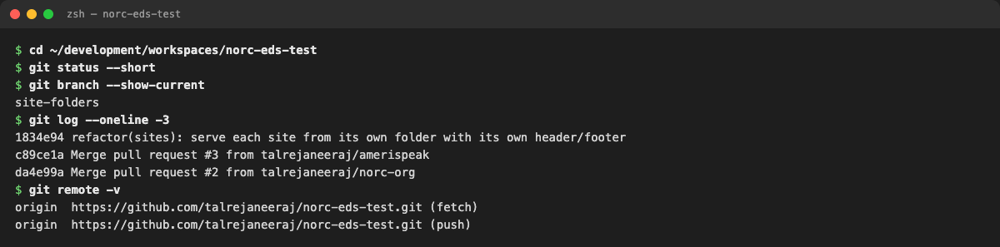
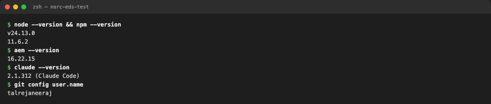
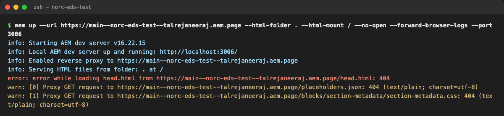
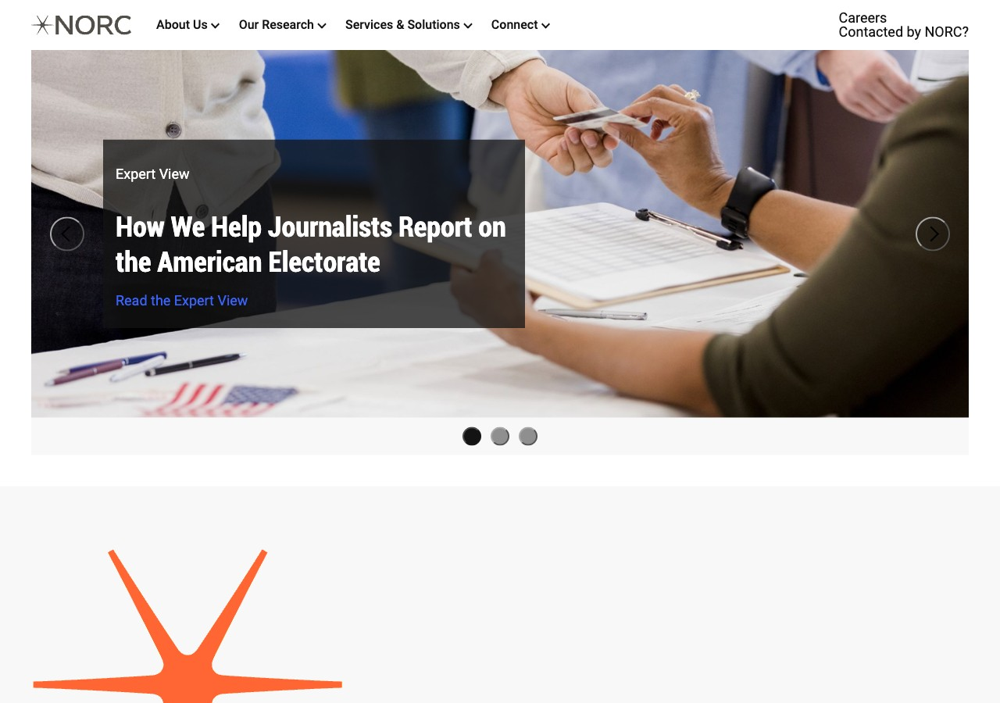
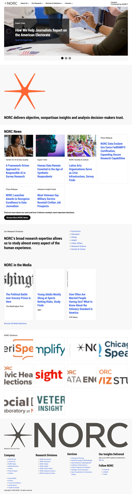
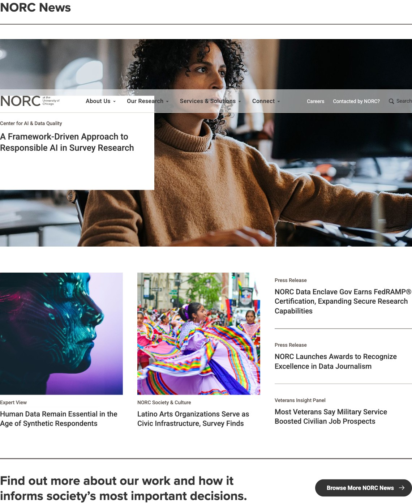
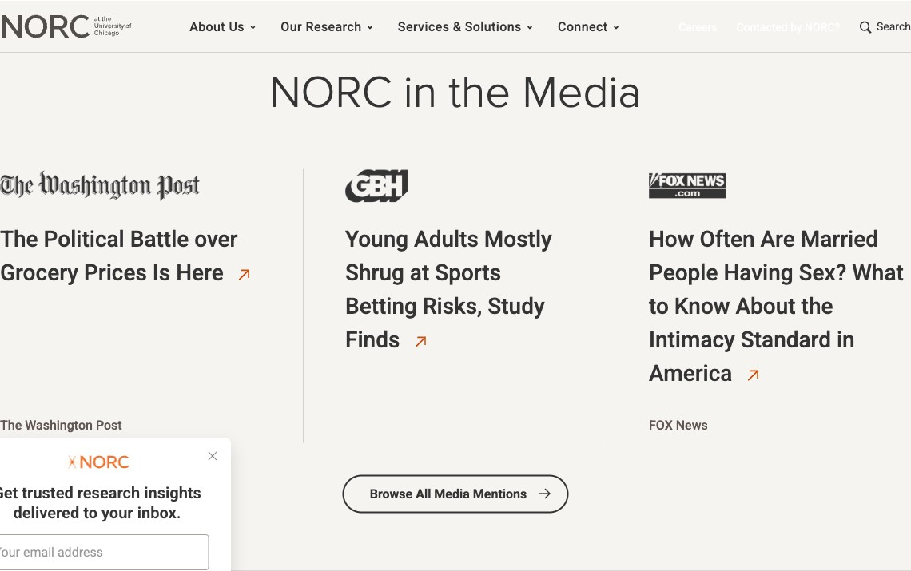
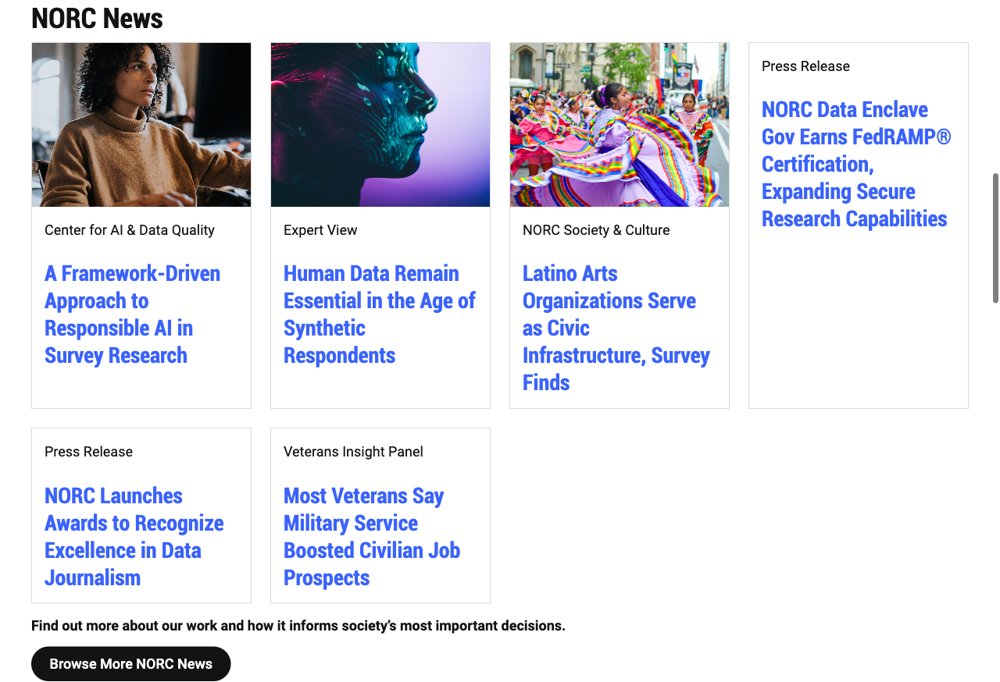
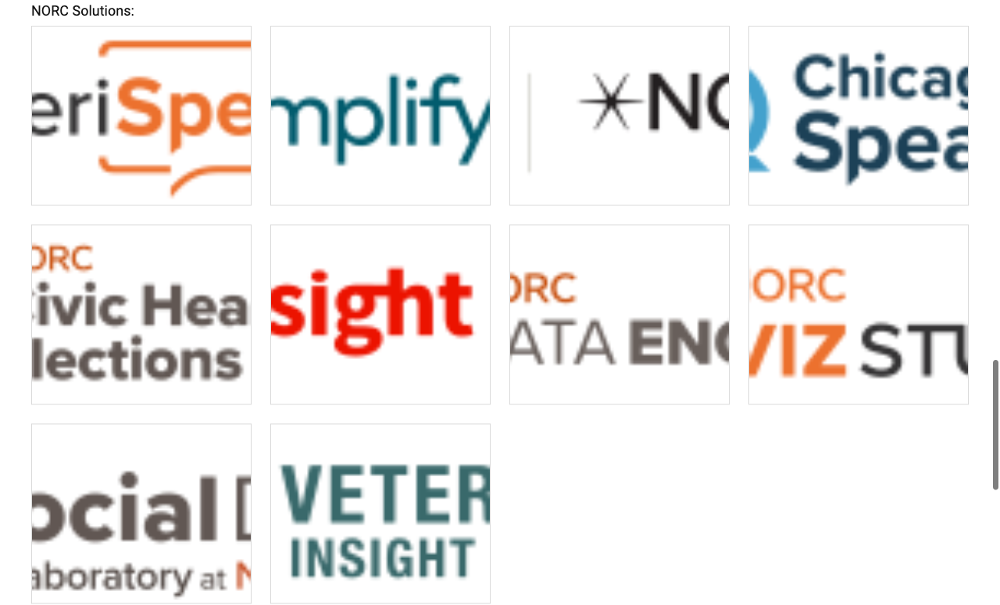

# What this lab is for

**Goal:** prove the Session 2 project still works *before* changing anything, and pick one realistic component to improve.

**Output:** a running local server, a recorded git baseline, and a chosen section with a reason.

| Item | Our value |
|---|---|
| Repository | github.com/talrejaneeraj/norc-eds-test |
| Local folder | `<your-workspace>/norc-eds-test` |
| Source NORC domain | https://www.norc.org/ |
| Imported page (local) | http://localhost:3006/norc/ |
| Selected section | **Cards** block: NORC News, NORC in the Media, NORC Solutions |

> **Say (opening, 20 seconds):** "We are not building anything new today. We take the NORC page we imported in Session 2 and make one part of it author-friendly and reusable. Step one is to show that the baseline works and record it, so we can prove later exactly what we changed."

# Step 1: Open the project and record the git baseline

**Do:** open a terminal and run:

```bash
cd <your-workspace>/norc-eds-test
git status --short
git branch --show-current
git log --oneline -3
git remote -v
```

**Show:**

{width=100%}

**Explain each line:**

- `git status --short` prints **nothing**, so there are no uncommitted changes. The worksheet bullet *"Recorded existing Git changes before editing"* is satisfied: there were none.
- `git branch --show-current` shows `site-folders`: the branch with the per-site folders from Session 2 (PR #4).
- `git log` shows the last commits, so we can always get back to this exact point.
- `git remote -v` shows **HTTPS** to the `talrejaneeraj` account. No SSH and no other user.

> **Say:** "Clean tree, known commit, correct account. If anything goes wrong later, this is the line we roll back to."

**If someone's `git status` is not clean:** commit or `git stash` it first. Never discard Session 2 work (prerequisites §3).

# Step 2: Check the tools (Mac + Claude Code version of the WSL checklist)

**Do:**

```bash
node --version && npm --version
aem --version
claude --version
git config user.name
```

**Show:**

{width=100%}

**Explain:** the prerequisites list Node via nvm, npm, the AEM CLI and an AI agent. On this Mac we use **Claude Code** in place of the GitHub Copilot CLI, with the same Adobe skills loaded from `github.com/adobe/skills`. Node 24, npm 11 and AEM CLI 16 are the versions we used throughout.

# Step 3: Start the local server

**Do:** in a **separate** terminal tab (it keeps running):

```bash
aem up --url https://main--norc-eds-test--talrejaneeraj.aem.page \
  --html-folder . --html-mount / --no-open --forward-browser-logs --port 3006
```

(`npm run start` does the same on port 3000.)

**Show:**

{width=100%}

**Explain the flags.** These are the questions people always ask:

| Flag | Why |
|---|---|
| `--url …aem.page` | Code and anything not on disk come from our site's preview |
| `--html-folder .` | Serve our imported pages straight from the repo folder (we have no DA content yet) |
| `--html-mount /` | Mount that folder at `/`, so `norc/index.plain.html` is served at `/norc/` |
| `--forward-browser-logs` | Browser console errors also print in this terminal |
| `--port 3006` | Leaves port 3000 free for anyone else |

**Explain the red and yellow lines** (they look scary but are expected):

- `error: … head.html … 404`: the remote preview has no content source yet, so the local `head.html` is used instead. Harmless.
- `warn: … placeholders.json 404` and `section-metadata.css 404`: two files that don't exist on this site. They were there before our change and are unrelated to Cards.

# Step 4: Show the imported page, not just the homepage

**Do:** open **http://localhost:3006/norc/** (the prerequisites say *"Validate the imported page path, not only the homepage"*).

**Show:**

{width=100%}

**Then scroll the whole page** and narrate the sections: carousel, highlight statement, NORC News, Research Divisions, NORC in the Media, NORC Solutions.

{width=45%}

# Step 5: Pick the candidate (the important part)

**Show the source site first** (prerequisites: *"Prepare a screenshot of your candidate source section"*):

{width=100%}

{width=100%}

{width=100%}

**Then show our imported version of the same three sections:**

{width=100%}

{width=100%}

{width=100%}

> **Say:** "Same content, three different shapes, and all three are the **Cards** block. That's our candidate. The logos are cropped, text-only news cards look unfinished, and only the title is clickable. None of this is the author's fault; it's the block."

## Why Cards and not something else

| Candidate on this page | Decision | Reason |
|---|---|---|
| **Cards** (3 sections, 19 items) | **Chosen** | Visible defects; 3 real content shapes; also used by AmeriSpeak and Amplify AAPI, so it's shareable |
| Carousel | Rejected | Interactive JS, buttons, accessibility: too big for a first lab |
| Columns (Research Divisions) | Rejected | One instance, nothing broken, no variation to model |
| Highlight statement | Rejected | Default content only; no block to model |

The prerequisites support this choice: *"Start with the existing Cards or Columns block if it already meets the need,"* and the facilitator notes say *"Demonstrate Cards/Columns first."*

# Worksheet fields: filled in

- ☒ Opened the Session 2 repository in the editor (VS Code on Mac instead of WSL)
- ☒ Started the local server and displayed the imported page (`/norc/`)
- ☒ Recorded existing git changes before editing (none; clean on `site-folders`)
- ☒ Selected a realistic component to improve

**Selected section:** the Cards block on `/norc/`: NORC News, NORC in the Media, NORC Solutions.

**Why change is needed:** logos are cropped (GBH and FOX invisible), cards without images look broken, category labels are unstyled, only the title is clickable, and title sizes are inconsistent.

# Questions you may get

- **"Why port 3006?"** It avoids clashing with someone's existing server on 3000. Any free port works.
- **"Why do I see a 404 at `/`?"** Each site lives in its own folder; use `/norc/`, `/amerispeak/` or `/amplifyaapi/`.
- **"Do I need DA or Universal Editor?"** No. The worksheet says not to require publishing for this lab.
